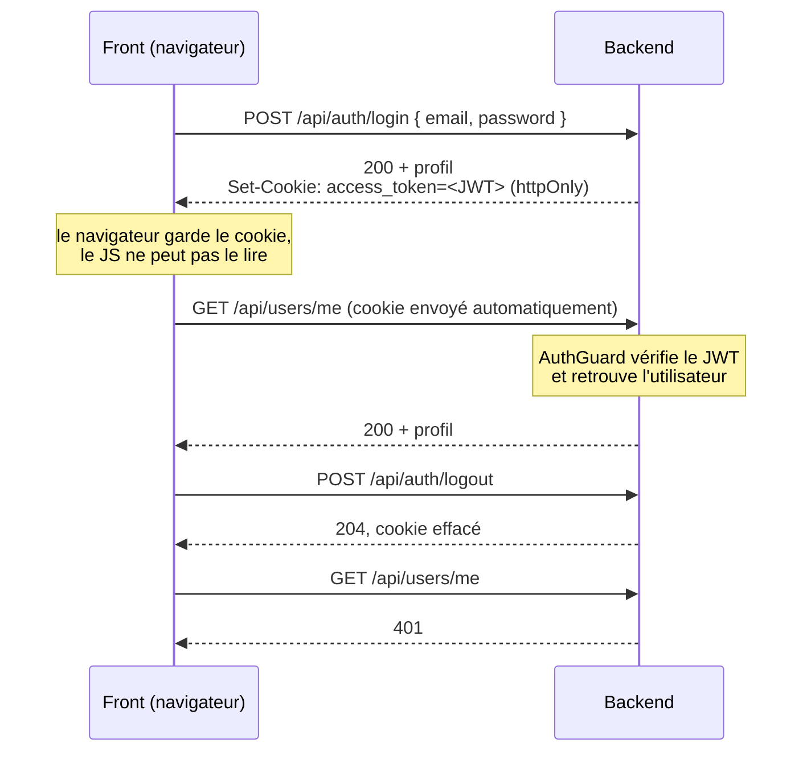

# API backend : routes et utilisation

Ce document liste les routes du backend NestJS et explique comment le frontend doit les appeler : URL, authentification par cookie, format des erreurs, limites de requêtes. Rédigé avec l'aide d'une IA (Claude), à relire et valider par l'équipe.

> [!NOTE]
> Pour le partage des types et des schémas entre back et front, voir [`docs/shared.md`](shared.md).
> Pour le routage `/api` dans nginx, voir [`docs/nginx.md`](nginx.md).

## Sommaire

1. [Appeler l'API](#1-appeler-lapi)
2. [Authentification](#2-authentification)
3. [Erreurs](#3-erreurs)
4. [Limites de requêtes](#4-limites-de-requêtes)
5. [Routes](#5-routes)
6. [Ajouter une route](#6-ajouter-une-route)

---

## 1. Appeler l'API

- **URL de base** : `https://localhost/api`. Nginx est le seul point d'entrée : il envoie `/api/*` au backend et tout le reste au frontend. Le préfixe `/api` vient de `app.setGlobalPrefix('api')` dans `backend/src/app.config.ts`.
- **Format** : JSON en entrée comme en sortie. Il faut envoyer `Content-Type: application/json` avec chaque corps de requête.
- **Dates** : les dates sont des chaînes ISO 8601 (`2026-11-07T20:00:00.000Z`). Seul `birthDate` à l'inscription s'écrit au format `YYYY-MM-DD`.
- **Identifiants** : tous les `:id` sont des UUID. Un id mal formé renvoie 400 avant même d'interroger la base.
- **Champs inconnus** : le backend refuse tout champ qui n'est pas prévu dans le corps de la requête (400, à cause de `forbidNonWhitelisted`). Il ne l'ignore pas.
- **Réponses filtrées** : chaque route déclare un schéma de réponse avec `@SerializeOptions`, et le backend ne renvoie que les champs de ce schéma. Un mot de passe ou un `deletedAt` ne peut donc pas sortir par accident.

Exemple d'appel depuis le front :

```ts
const res = await fetch('/api/reservations', {
  method: 'POST',
  credentials: 'include', // obligatoire : envoie le cookie de session
  headers: { 'Content-Type': 'application/json' },
  body: JSON.stringify({ seatId, arrivalAt: arrivalAt.toISOString() }),
});
if (!res.ok) {
  const error = await res.json(); // { statusCode, message, error }
  // ...
}
const reservation: Reservation = await res.json();
```

## 2. Authentification

### Route publique ou route privée

- **Privée** (par défaut) : il faut être connecté. Sans session valide, la route renvoie **401**.
- **Publique** : marquée `@Public()` dans le contrôleur. Tout le monde peut l'appeler.

Toutes les routes sont privées par défaut, parce que le garde d'authentification est global (`APP_GUARD` dans `backend/src/auth/auth.module.ts`). Si on oublie `@Public()`, la route est donc fermée au lieu d'être ouverte par erreur.

### Le cycle d'une session



1. **Connexion** : `POST /api/auth/login` vérifie l'email et le mot de passe. Le backend crée alors un **JWT** signé (HS256) qui contient l'id et le rôle de l'utilisateur, et le pose dans le cookie `access_token`.
2. **Requêtes suivantes** : le navigateur renvoie le cookie tout seul. Avant chaque route privée, `AuthGuard` (`backend/src/auth/auth.guard.ts`) vérifie :
   - que le cookie est présent ;
   - que la signature du JWT est valide et qu'il n'a pas expiré ;
   - que l'utilisateur existe toujours et n'est pas supprimé.

   Si un de ces contrôles échoue, la route renvoie 401. Sinon, `req.user = { id, role }` est disponible dans la route grâce à `@CurrentUser()`.
3. **Déconnexion** : `POST /api/auth/logout` efface le cookie.

### Le cookie

| Option | Valeur | Pourquoi |
|---|---|---|
| Nom | `access_token` | |
| `httpOnly` | `true` | Le JavaScript ne peut pas le lire : un script injecté (XSS) ne peut pas voler la session |
| `sameSite` | `lax` | Le cookie n'est pas envoyé par les requêtes `POST` venant d'autres sites (protection CSRF) |
| `secure` | `true` en production | Le cookie ne passe que par HTTPS |
| Durée de vie | `JWT_EXPIRES_IN_SECONDS` (`.env`, 3600 s par défaut) | Après ce délai, la route renvoie 401 et il faut se reconnecter |

### Ce que ça implique pour le front

- **Envoyer le cookie** : il faut ajouter `credentials: 'include'` à chaque `fetch`. Sans ça, le navigateur n'envoie pas le cookie et toutes les routes privées renvoient 401.
- **Ne pas stocker le jeton** : le front ne le voit jamais, et il n'y a rien à mettre dans `localStorage`.
- **Savoir si l'utilisateur est connecté** : appeler `GET /api/users/me`. Une réponse 200 renvoie l'utilisateur, une réponse 401 veut dire qu'il n'est pas connecté.
- **Gérer le 401** : sur n'importe quelle route, il veut dire « session absente ou expirée ». Le front redirige alors vers la page de connexion.
- **Ne pas envoyer d'id utilisateur** : le backend prend l'identité dans le JWT, pas dans le corps de la requête. Le front ne peut pas agir au nom d'un autre joueur.

> [!WARNING]
> **Connecté ne veut pas dire autorisé.** Le rôle (`USER` ou `ADMIN`) est bien dans `req.user`, mais aucune route ne le vérifie pour l'instant. Tout utilisateur connecté peut donc créer, modifier ou supprimer une table. Les rôles de casino (`OWNER`, `FLOOR`) arrivent avec TSK-43.

## 3. Erreurs

Toutes les erreurs suivent le format par défaut de NestJS :

```json
{ "statusCode": 409, "message": "This seat already has an active reservation", "error": "Conflict" }
```

Pour une erreur de validation (400), `message` est un **tableau**, avec un élément par champ invalide :

```json
{ "statusCode": 400, "message": ["email must be an email"], "error": "Bad Request" }
```

| Code | Signification |
|---|---|
| 400 | Corps ou paramètre invalide, champ en trop, règle métier non respectée (casino fermé, blinds incohérentes…) |
| 401 | Pas connecté, session expirée, ou identifiants incorrects au login |
| 404 | Ressource introuvable ou supprimée |
| 409 | Conflit : email ou pseudo déjà pris, place déjà réservée… |
| 429 | Trop de requêtes (voir la section suivante) |
| 503 | Base de données injoignable (`/api/health`) |

## 4. Limites de requêtes

Un `ThrottlerGuard` global limite le nombre de requêtes par IP (`backend/src/app.module.ts`). Au-delà de la limite, la route renvoie **429**.

| Portée | Limite |
|---|---|
| Par défaut | 100 requêtes par 10 minutes |
| `POST /api/auth/register` | 3 par minute |
| `POST /api/auth/login` | 5 par minute (protection contre le brute-force) |
| `/api/health` | Aucune limite |

L'IP du client est celle transmise par nginx (`X-Forwarded-For`, avec `trust proxy` activé). En test, on peut couper la limite avec `THROTTLE_DISABLED=true`.

## 5. Routes

**Privé** : il faut être connecté. **Public** : accessible sans connexion.

### Santé

| Méthode | Route | Accès | Corps | Réponse |
|---|---|---|---|---|
| GET | `/api` | Privé | – | Chaîne "hello" (route de démo) |
| GET | `/api/health` | Public | – | `{ status }`, ou 503 si la base est injoignable |
| POST | `/api/health` | Public | `{ name }` | Route de test |

### Authentification

| Méthode | Route | Accès | Corps | Réponse |
|---|---|---|---|---|
| POST | `/api/auth/register` | Public | Voir ci-dessous | 201 + profil (`myProfileUserSchema`) |
| POST | `/api/auth/login` | Public | `email`, `password` | 200 + profil, et pose le cookie |
| POST | `/api/auth/logout` | Public | – | 204, et efface le cookie |

Corps de `register` :

| Champ | Règle |
|---|---|
| `firstName`, `lastName` | Obligatoires, 50 caractères max (espaces retirés au début et à la fin) |
| `pseudo` | De 1 à 20 caractères, `a-z`, `0-9`, `_` et `-` uniquement (passé en minuscules) |
| `email` | Email valide, 254 caractères max (passé en minuscules) |
| `password` | Mot de passe fort (8 caractères minimum, avec une minuscule, une majuscule, un chiffre et un symbole), 128 caractères max |
| `birthDate` | `YYYY-MM-DD`, 18 ans minimum, pas avant 1900 |
| `phone` | Optionnel, numéro suisse |

Erreurs : 409 si l'email ou le pseudo est déjà pris. Au login, 401 `Invalid credentials` si l'email ou le mot de passe est faux (le message ne dit pas lequel des deux).

> [!NOTE]
> L'inscription **ne connecte pas** l'utilisateur : il faut appeler `login` ensuite.

### Utilisateurs

| Méthode | Route | Accès | Réponse |
|---|---|---|---|
| GET | `/api/users/me` | Privé | Profil complet de l'utilisateur connecté |
| GET | `/api/users/:id` | Public | Profil public : `{ pseudo }`. 404 si l'utilisateur est introuvable ou supprimé |

Profil complet (`myProfileUserSchema`) : `id`, `email`, `pseudo`, `firstName`, `lastName`, `phone` (ou `null`), `birthDate`, `role`, `createdAt`, `updatedAt`.

### Casinos

Aucune route pour l'instant. Les casinos, les adhésions et les rôles de casino arrivent avec TSK-43.

### Tables

| Méthode | Route | Accès | Corps | Réponse |
|---|---|---|---|---|
| GET | `/api/tables` | Privé | – | `Table[]` |
| GET | `/api/tables/:id` | Privé | – | `Table`, 404 si la table est introuvable ou supprimée |
| POST | `/api/tables` | Privé | `casinoId`, `name`, `variant`, `smallBlind`, `bigBlind`, `maxSeats` | 201 + `Table` |
| PATCH | `/api/tables/:id` | Privé | Tous les champs optionnels : `variant`, `smallBlind`, `bigBlind`, `moneyOnTable`, `status` | `Table` |
| DELETE | `/api/tables/:id` | Privé | – | 204 (suppression logique : la table reçoit un `deletedAt`) |

Règles :
- `variant` vaut `TEXAS_HOLDEM` ou `OMAHA`, et `status` vaut `OPEN` ou `PAUSED`.
- `smallBlind` et `bigBlind` sont des entiers ≥ 1, et `bigBlind` doit être ≥ `smallBlind` (sinon 400).
- `maxSeats` va de 2 à 10, et 8 au maximum en `OMAHA` (sinon 400).
- `moneyOnTable` est un entier ≥ 0.
- Un `casinoId` inconnu renvoie 400.

Schéma de réponse `Table` (`shared/src/tables.ts`) : `id`, `casinoId`, `name`, `variant`, `smallBlind`, `bigBlind`, `maxSeats`, `status`, `moneyOnTable`, et `seats` (tableau de `{ id, seatNumber, status }`, où `status` vaut `FREE` ou `OCCUPIED`).

### Réservations

| Méthode | Route | Accès | Corps | Réponse | État |
|---|---|---|---|---|---|
| POST | `/api/reservations` | Privé | `seatId`, `arrivalAt` | 201 + `Reservation` (statut `PENDING_PAYMENT`) | Existe |
| GET | `/api/reservations` | Privé | – | `Reservation[]` du joueur connecté | Existe |
| GET | `/api/reservations/:id` | Privé | – | `Reservation`, 404 si elle appartient à un autre joueur | Prévu |
| DELETE | `/api/reservations/:id` | Privé | – | 200 + `Reservation` annulée (statut `CANCELLED`, `cancelledAt` rempli) | Existe |

**Rôle** : toutes les routes de réservation sont limitées au rôle `USER` (`@Roles(Role.USER)` sur le contrôleur). Un compte `ADMIN` ne joue pas et reçoit 403.

Règles de `POST /api/reservations` :
- **Date d'arrivée** : `arrivalAt` doit être dans le futur et dans les 7 jours (sinon 400).
- **Fermeture** : les casinos sont fermés de 5h à 8h, heure de Paris. Une arrivée dans ce créneau renvoie 400.
- **Journée casino** : elle va de 8h à 5h le lendemain. Une arrivée à 2h du matin compte donc pour la veille.
- **Une seule réservation active** (`PENDING_PAYMENT`, `CONFIRMED` ou `SEATED`) par place et par journée casino, et une seule par joueur et par journée casino. Sinon 409.
- **Arrivée le jour même** : la table doit être `OPEN` et la place `FREE`, sinon 409. Pour un autre jour, l'état actuel de la table ou de la place ne compte pas.
- **Place introuvable** : une place inconnue ou supprimée renvoie 400.

Règles de `GET /api/reservations` :
- **Uniquement ses réservations** : le joueur est identifié par son cookie de session. Un `userId` passé dans l'URL est ignoré.
- **Toutes les réservations**, y compris les annulées ou expirées (historique). Le front filtre selon `status` s'il ne veut que les actives.
- **Ordre** : par `arrivalAt` décroissant, l'arrivée la plus lointaine en premier.
- Un joueur sans réservation reçoit `[]`.

Règles de `DELETE /api/reservations/:id` :
- **Pas de suppression** : la réservation reste en base, avec le statut `CANCELLED` et la date d'annulation dans `cancelledAt`. Elle reste visible dans `GET /api/reservations`.
- **Ses propres réservations seulement** : la réservation d'un autre joueur renvoie 404, comme un id inconnu, pour ne pas révéler qu'elle existe.
- **Statut** : seule une réservation `CONFIRMED` peut être annulée. Pour tout autre statut, y compris `PENDING_PAYMENT` (qui expire seule si le paiement n'aboutit pas), la route renvoie 409.
- **Délai** : l'annulation est refusée (409) dès que l'heure d'arrivée est atteinte.
- **Place libérée** : une fois la réservation annulée, la place est de nouveau réservable pour cette journée casino, par n'importe quel joueur.
- Si la réservation change de statut pendant la requête (par exemple le joueur est marqué arrivé), la route renvoie 409 au lieu d'annuler.

| Code | Message (`message`) |
|---|---|
| 400 | `Validation failed (uuid is expected)` : l'id n'est pas un UUID |
| 404 | `Reservation not found` |
| 409 | `Only a confirmed reservation can be cancelled` |
| 409 | `The arrival time has passed` |
| 409 | `The reservation changed and can no longer be cancelled` |

Expiration des réservations non payées (aucune route, tâche planifiée) :
- **Délai** : une réservation `PENDING_PAYMENT` doit être payée dans les **15 minutes** qui suivent sa création (`createdAt`).
- **Passage en `EXPIRED`** : une tâche planifiée tourne **toutes les minutes** et passe en `EXPIRED` les réservations dont le délai est dépassé. Une réservation peut donc rester en `PENDING_PAYMENT` jusqu'à une minute après la fin du délai.
- **Place et joueur libérés** : une réservation `EXPIRED` n'est plus active. La place redevient réservable pour cette journée casino, et le joueur peut de nouveau réserver ce jour-là.
- **Historique** : la réservation n'est pas supprimée, elle reste visible dans `GET /api/reservations` avec le statut `EXPIRED`.
- Côté code : `ReservationsService.expirePendingPayments()` (délai `PAYMENT_DELAY_MS`), appelée par `ReservationsScheduler` (`backend/src/reservations/utils/reservations.scheduler.ts`).

Schéma de réponse `Reservation` (`shared/src/reservations.ts`) : `id`, `userId`, `seatId`, `status`, `arrivalAt`, `createdAt`, `updatedAt`, `seatedAt`, `leftAt`, `cancelledAt` (les trois derniers peuvent valoir `null`).

Statuts possibles : `PENDING_PAYMENT`, `CONFIRMED`, `SEATED`, `COMPLETED`, `CANCELLED`, `NO_SHOW`, `EXPIRED`.

## 6. Ajouter une route

1. Écrire la route dans le contrôleur du domaine (`backend/src/<domaine>/<domaine>.controller.ts`).
2. **Déclarer un schéma de réponse** avec `@SerializeOptions({ schema })`. Sans ça, la route renvoie 500 (`missingResponseSchema` dans `backend/src/common/`). Si le front doit aussi connaître ce schéma, il va dans `shared/` (voir [`docs/shared.md`](shared.md)).
3. **Valider le corps** avec un DTO `class-validator` dans `dto/`.
4. Ajouter `@Public()` **seulement** si la route doit être accessible sans connexion.
5. Ajouter `@Throttle(...)` si la route est sensible (login, envoi d'emails…).
6. Mettre à jour ce document.
