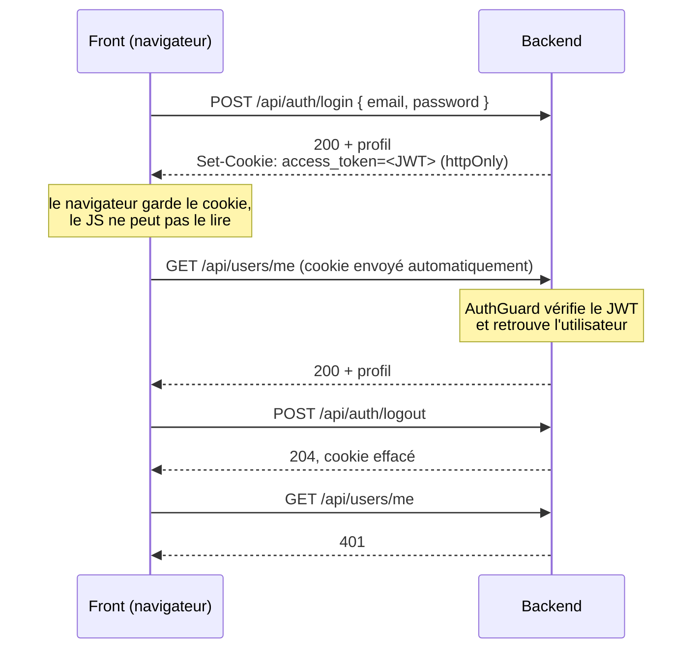
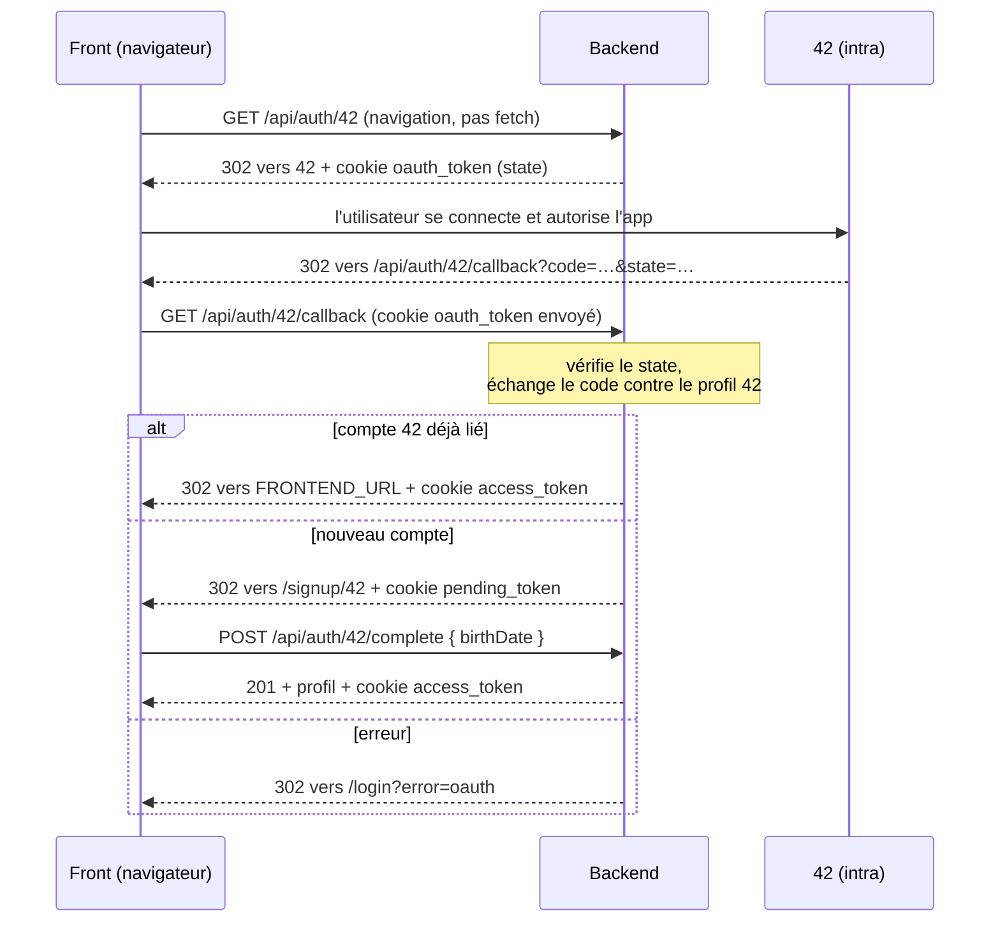
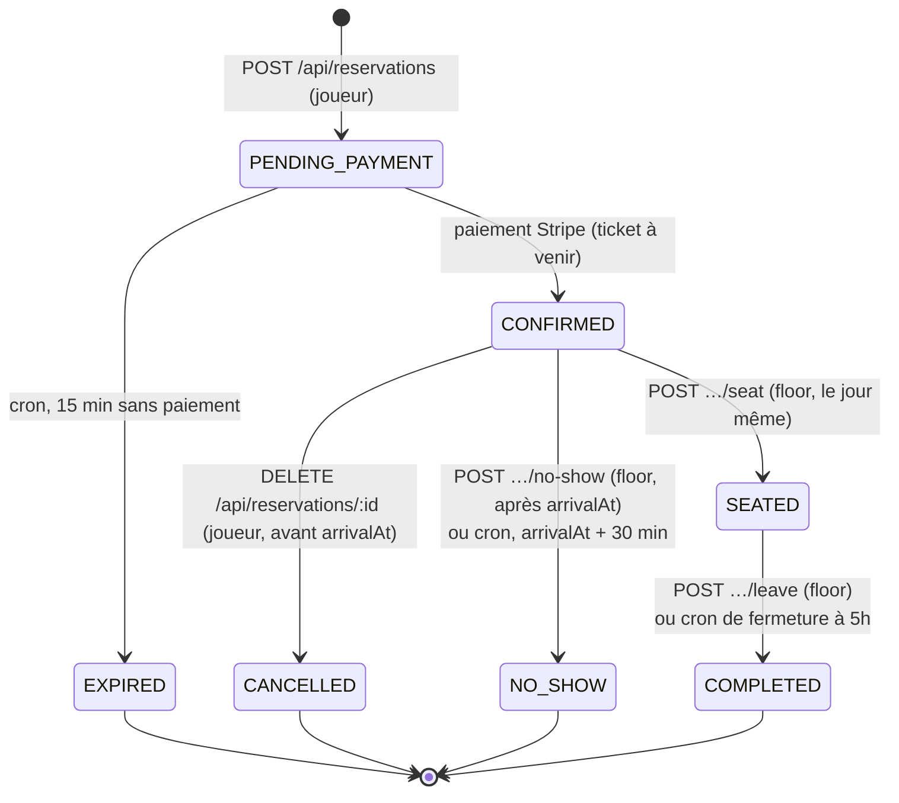

# API backend : routes et utilisation

Ce document liste les routes du backend NestJS et explique comment le frontend doit les appeler : URL, authentification par cookie, format des erreurs, limites de requêtes. Rédigé avec l'aide d'une IA (Claude), à relire et valider par l'équipe.

> [!NOTE]
> Pour la liste de toutes les routes sur une page (conditions et rôle de chaque route), voir [`docs/routes.md`](routes.md).
> Pour le partage des types et des schémas entre back et front, voir [`docs/shared.md`](shared.md).
> Pour le routage `/api` dans nginx, voir [`docs/nginx.md`](nginx.md).

## Sommaire

1. [Appeler l'API](#1-appeler-lapi)
2. [Authentification](#2-authentification)
3. [Erreurs](#3-erreurs)
4. [Limites de requêtes](#4-limites-de-requêtes)
5. [Routes](#5-routes)
6. [Ajouter une route](#6-ajouter-une-route)

---

## 1. Appeler l'API

- **URL de base** : `https://localhost/api`. Nginx est le seul point d'entrée : il envoie `/api/*` au backend et tout le reste au frontend. Le préfixe `/api` vient de `app.setGlobalPrefix('api')` dans `backend/src/app.config.ts`.
- **Format** : JSON en entrée comme en sortie. Il faut envoyer `Content-Type: application/json` avec chaque corps de requête.
- **Dates** : les dates sont des chaînes ISO 8601 (`2026-11-07T20:00:00.000Z`). Seul `birthDate` à l'inscription s'écrit au format `YYYY-MM-DD`.
- **Identifiants** : tous les `:id` sont des UUID. Un id mal formé renvoie 400 avant même d'interroger la base.
- **Champs inconnus** : le backend refuse tout champ qui n'est pas prévu dans le corps de la requête (400, à cause de `forbidNonWhitelisted`). Il ne l'ignore pas.
- **Réponses filtrées** : chaque route déclare un schéma de réponse avec `@SerializeOptions`, et le backend ne renvoie que les champs de ce schéma. Un mot de passe ou un `deletedAt` ne peut donc pas sortir par accident.

Exemple d'appel depuis le front :

```ts
const res = await fetch('/api/reservations', {
  method: 'POST',
  credentials: 'include', // obligatoire : envoie le cookie de session
  headers: { 'Content-Type': 'application/json' },
  body: JSON.stringify({ seatId, arrivalAt: arrivalAt.toISOString() }),
});
if (!res.ok) {
  const error = await res.json(); // { statusCode, message, error }
  // ...
}
const reservation: Reservation = await res.json();
```

## 2. Authentification

### Route publique ou route privée

- **Privée** (par défaut) : il faut être connecté. Sans session valide, la route renvoie **401**.
- **Publique** : marquée `@Public()` dans le contrôleur. Tout le monde peut l'appeler.

Toutes les routes sont privées par défaut, parce que le garde d'authentification est global (`APP_GUARD` dans `backend/src/auth/auth.module.ts`). Si on oublie `@Public()`, la route est donc fermée au lieu d'être ouverte par erreur.

### Le cycle d'une session



1. **Connexion** : `POST /api/auth/login` vérifie l'email et le mot de passe. Le backend crée alors un **JWT** signé (HS256) qui contient l'id et le rôle de l'utilisateur, et le pose dans le cookie `access_token`.
2. **Requêtes suivantes** : le navigateur renvoie le cookie tout seul. Avant chaque route privée, `AuthGuard` (`backend/src/auth/auth.guard.ts`) vérifie :
   - que le cookie est présent ;
   - que la signature du JWT est valide et qu'il n'a pas expiré ;
   - que l'utilisateur existe toujours et n'est pas supprimé.

   Si un de ces contrôles échoue, la route renvoie 401. Sinon, `req.user = { id, role }` est disponible dans la route grâce à `@CurrentUser()`.
3. **Déconnexion** : `POST /api/auth/logout` efface le cookie.

### Le cookie

| Option | Valeur | Pourquoi |
|---|---|---|
| Nom | `access_token` | |
| `httpOnly` | `true` | Le JavaScript ne peut pas le lire : un script injecté (XSS) ne peut pas voler la session |
| `sameSite` | `lax` | Le cookie n'est pas envoyé par les requêtes `POST` venant d'autres sites (protection CSRF) |
| `secure` | `true` en production | Le cookie ne passe que par HTTPS |
| Durée de vie | `JWT_EXPIRES_IN_SECONDS` (`.env`, 3600 s par défaut) | Après ce délai, la route renvoie 401 et il faut se reconnecter |

### Ce que ça implique pour le front

- **Envoyer le cookie** : il faut ajouter `credentials: 'include'` à chaque `fetch`. Sans ça, le navigateur n'envoie pas le cookie et toutes les routes privées renvoient 401.
- **Ne pas stocker le jeton** : le front ne le voit jamais, et il n'y a rien à mettre dans `localStorage`.
- **Savoir si l'utilisateur est connecté** : appeler `GET /api/users/me`. Une réponse 200 renvoie l'utilisateur, une réponse 401 veut dire qu'il n'est pas connecté.
- **Gérer le 401** : sur n'importe quelle route, il veut dire « session absente ou expirée ». Le front redirige alors vers la page de connexion.
- **Ne pas envoyer d'id utilisateur** : le backend prend l'identité dans le JWT, pas dans le corps de la requête. Le front ne peut pas agir au nom d'un autre joueur.

### Rôles de casino

Les routes sous `/api/casinos/:casinoId/...` qui modifient un casino exigent un **rôle dans ce casino** (table `Membership`), vérifié par `CasinoRoleGuard` (`@RequireCasinoRole(...)`, `backend/src/casinos/`).

| Rôle | Peut faire |
|---|---|
| `OWNER` | Tout ce que fait `FLOOR`, plus la configuration des tables (création, `PUT`, suppression) |
| `FLOOR` | État des tables et des places, liste floor des réservations, check-in, départ, no-show |

- **Hiérarchie** : `OWNER` passe partout où `FLOOR` est demandé.
- **Admin** : un compte `ADMIN` (rôle global) passe toutes les vérifications de rôle de casino.
- **Pas membre du casino** (ou casino inconnu ou supprimé) : **404**, comme si le casino n'existait pas. On ne révèle pas son existence.
- **Membre avec un rôle trop faible** (`FLOOR` sur une route `OWNER`) : **403**.

## 3. Erreurs

Toutes les erreurs suivent le format par défaut de NestJS :

```json
{ "statusCode": 409, "message": "This seat already has an active reservation", "error": "Conflict" }
```

Pour une erreur de validation (400), `message` est un **tableau**, avec un élément par champ invalide :

```json
{ "statusCode": 400, "message": ["email must be an email"], "error": "Bad Request" }
```

| Code | Signification |
|---|---|
| 400 | Corps ou paramètre invalide, champ en trop, règle métier non respectée (casino fermé, blinds incohérentes…) |
| 401 | Pas connecté, session expirée, ou identifiants incorrects au login |
| 403 | Connecté, mais rôle insuffisant (rôle global ou rôle de casino, voir [Rôles de casino](#rôles-de-casino)) |
| 404 | Ressource introuvable ou supprimée, ressource d'un autre casino, ou casino dont on n'est pas membre |
| 409 | Conflit : email ou pseudo déjà pris, place déjà réservée, transition de statut impossible… |
| 429 | Trop de requêtes (voir la section suivante) |
| 503 | Base de données injoignable (`/api/health`) |

## 4. Limites de requêtes

Un `ThrottlerGuard` global limite le nombre de requêtes par IP (`backend/src/app.module.ts`). Au-delà de la limite, la route renvoie **429**.

| Portée | Limite |
|---|---|
| Par défaut | 100 requêtes par 10 minutes |
| `POST /api/auth/register` | 3 par minute |
| `POST /api/auth/login` | 5 par minute (protection contre le brute-force) |
| `GET /api/auth/42`, `GET /api/auth/42/callback`, `POST /api/auth/42/complete` | 5 par minute chacune |
| `/api/health` | Aucune limite |

L'IP du client est celle transmise par nginx (`X-Forwarded-For`, avec `trust proxy` activé). En test, on peut couper la limite avec `THROTTLE_DISABLED=true`.

## 5. Routes

**Privé** : il faut être connecté. **Public** : accessible sans connexion. **`OWNER`** / **`FLOOR`** : il faut ce rôle (ou plus) dans le casino de l'URL, voir [Rôles de casino](#rôles-de-casino).

### Santé

| Méthode | Route | Accès | Corps | Réponse |
|---|---|---|---|---|
| GET | `/api` | Privé | – | Chaîne "hello" (route de démo) |
| GET | `/api/health` | Public | – | `{ status }`, ou 503 si la base est injoignable |
| POST | `/api/health` | Public | `{ name }` | Route de test |

### Authentification

| Méthode | Route | Accès | Corps | Réponse |
|---|---|---|---|---|
| POST | `/api/auth/register` | Public | Voir ci-dessous | 201 + profil (`myProfileUserSchema`) |
| POST | `/api/auth/login` | Public | `email`, `password` | 200 + profil, et pose le cookie |
| POST | `/api/auth/logout` | Public | – | 204, et efface le cookie |

Corps de `register` :

| Champ | Règle |
|---|---|
| `firstName`, `lastName` | Obligatoires, 50 caractères max (espaces retirés au début et à la fin) |
| `pseudo` | De 1 à 20 caractères, `a-z`, `0-9`, `_` et `-` uniquement (passé en minuscules). Ne peut pas commencer par `42` (préfixe réservé aux comptes 42, voir plus bas) |
| `email` | Email valide, 254 caractères max (passé en minuscules) |
| `password` | Mot de passe fort (8 caractères minimum, avec une minuscule, une majuscule, un chiffre et un symbole), 128 caractères max |
| `birthDate` | `YYYY-MM-DD`, 18 ans minimum, pas avant 1900 |
| `phone` | Optionnel, numéro suisse |

Erreurs : 409 si l'email ou le pseudo est déjà pris. Au login, 401 `Invalid credentials` si l'email ou le mot de passe est faux (le message ne dit pas lequel des deux).

> [!NOTE]
> L'inscription **ne connecte pas** l'utilisateur : il faut appeler `login` ensuite.

### Connexion avec 42

| Méthode | Route | Accès | Corps | Réponse |
|---|---|---|---|---|
| GET | `/api/auth/42` | Public | – | 302 vers la page d'autorisation de 42 |
| GET | `/api/auth/42/callback` | Public | – (appelée par 42) | 302 vers le front, voir le tableau des redirections |
| POST | `/api/auth/42/complete` | Public | `birthDate` (`YYYY-MM-DD`) | 201 + profil (`myProfileUserSchema`), et pose le cookie de session |

#### Le parcours



1. **Démarrer** : le bouton « Se connecter avec 42 » est un **lien** vers `/api/auth/42` (`<a href>` ou `window.location`), pas un `fetch`. Le navigateur doit suivre les redirections jusqu'à 42 puis revenir.
2. **Callback** : 42 renvoie le navigateur vers `/api/auth/42/callback`. Le backend vérifie que le paramètre `state` correspond au cookie `oauth_token` (protection CSRF), puis récupère le profil 42. Cette route ne renvoie **jamais de JSON** : elle redirige toujours vers le front.
3. **Finaliser l'inscription** : pour un nouveau compte, la page `/signup/42` du front demande la date de naissance, puis appelle `POST /api/auth/42/complete` avec `credentials: 'include'`. Le compte est créé à ce moment-là, pas avant.

#### Les redirections du callback

| Cas | Redirection | Cookie posé |
|---|---|---|
| Compte 42 déjà lié | `FRONTEND_URL` | `access_token` (session normale) |
| Compte 42 inconnu | `FRONTEND_URL/signup/42` | `pending_token` (10 minutes) |
| Toute erreur | `FRONTEND_URL/login?error=oauth` | aucun |

« Toute erreur » regroupe : `state` absent ou différent du cookie, `code` absent, refus ou panne de 42, compte supprimé, email déjà utilisé par un autre compte. Le backend renvoie **la même redirection** dans tous les cas, exprès : il ne dit pas lequel. Le front affiche un message générique, par exemple « Connexion avec 42 impossible. Si vous avez déjà un compte, connectez-vous avec votre mot de passe. »

Après une redirection vers `FRONTEND_URL`, le front appelle `GET /api/users/me` pour charger l'utilisateur, comme après un login classique.

#### `POST /api/auth/42/complete`

- **Corps** : uniquement `birthDate`, avec les mêmes règles qu'à l'inscription (18 ans minimum). Tout autre champ (`email`, `pseudo`…) renvoie 400 : l'identité vient du profil 42, jamais du front.
- **Compte créé** : email, prénom et nom repris de 42. Pseudo `42<login>` (par exemple `42jdoe`). Pas de mot de passe.
- **Erreurs** :

| Code | Cas | Ce que fait le front |
|---|---|---|
| 400 | Date de naissance invalide ou moins de 18 ans | Affiche l'erreur sur le champ |
| 401 | Cookie `pending_token` absent, invalide ou expiré (plus de 10 minutes) | Propose de recommencer la connexion avec 42 |
| 409 | Compte déjà créé (double envoi), ou email ou pseudo pris entre-temps | Message générique, le message ne dit pas quel champ |

#### Les cookies

| Cookie | Contenu | Path | Durée |
|---|---|---|---|
| `oauth_token` | `state` aléatoire (32 octets en hex) | `/api/auth/42` | 10 minutes, effacé au callback |
| `pending_token` | JWT signé avec `OAUTH_PENDING_SECRET` (profil 42) | `/api/auth/42` | 10 minutes, effacé après `complete` |
| `access_token` | La session normale (voir la [section 2](#2-authentification)) | `/` | `JWT_EXPIRES_IN_SECONDS` |

Les deux cookies OAuth sont `httpOnly` et `sameSite: lax`, comme la session. Leur `path` les limite aux routes 42 : le navigateur ne les envoie nulle part ailleurs. Nginx ne doit donc **pas** retirer le préfixe `/api`, sinon le navigateur ne les renvoie plus.

`pending_token` est signé avec un secret **différent** de celui de la session : il ne peut pas servir à se connecter, et `AuthGuard` le refuse (401).

#### Règles de sécurité retenues

- **Email (option A)** : on fait confiance à l'email fourni par 42, parce que c'est 42 qui l'attribue et le vérifie (`login@student.42xxx.fr`). Si un compte existe déjà avec cet email, la connexion est **refusée**. Il n'y a **aucune liaison automatique** à un compte existant. Ce choix ne vaut que pour un fournisseur qui vérifie les emails : il faudra le revoir avant d'ajouter GitHub ou Google.
- **Préfixe `42` réservé** : un pseudo qui commence par `42` vient forcément de 42 OAuth. `register` refuse ce préfixe : sinon quelqu'un pourrait prendre `42jdoe` avant le vrai jdoe, qui ne pourrait plus jamais s'inscrire. Les constantes (`OAUTH_PSEUDO_PREFIX`, `PSEUDO_PATTERN`, `PSEUDO_MAX_LEN`) sont dans `shared/src/pseudo.ts`.
- **Compte 42 seul** : un compte créé par 42 n'a pas de mot de passe. `POST /api/auth/login` le refuse avec le 401 générique habituel.
- **Compte supprimé** : un compte 42 lié à un utilisateur supprimé (RGPD) ne peut plus se connecter.

#### Configuration (`.env`)

| Variable | Exemple | Rôle |
|---|---|---|
| `FORTY_TWO_UID`, `FORTY_TWO_SECRET` | – | Identifiants de l'application sur l'intra 42 |
| `FORTY_TWO_CALLBACK_URL` | `https://localhost/api/auth/42/callback` | Doit être **identique** à l'URL de redirection déclarée sur l'intra |
| `FORTY_TWO_BASE_URL` | `https://api.intra.42.fr` | |
| `FORTY_TWO_AUTHORIZE`, `FORTY_TWO_TOKEN`, `FORTY_TWO_PROFILE` | `/oauth/authorize`, `/oauth/token`, `/v2/me` | Chemins ajoutés à `FORTY_TWO_BASE_URL` |
| `FORTY_TWO_TIMEOUT` | `5000` | Délai max d'un appel à 42, en ms (entier positif) |
| `OAUTH_PENDING_SECRET` | `openssl rand -hex 32` | Secret du `pending_token`, **différent** de `JWT_SECRET` |
| `FRONTEND_URL` | `https://localhost` | Base des redirections. Doit contenir le schéma (`https://`) |

Le backend refuse de démarrer si une de ces variables manque. En test, `backend/test/setup-env.ts` leur donne des valeurs factices : les tests n'appellent jamais 42.

### Utilisateurs

| Méthode | Route | Accès | Réponse |
|---|---|---|---|
| GET | `/api/users/me` | Privé | Profil complet de l'utilisateur connecté |
| GET | `/api/users/:id` | Public | Profil public : `{ pseudo }`. 404 si l'utilisateur est introuvable ou supprimé |

Profil complet (`myProfileUserSchema`) : `id`, `email`, `pseudo`, `firstName`, `lastName`, `phone` (ou `null`), `birthDate`, `role`, `createdAt`, `updatedAt`.

### Casinos

Liste des routes seulement (casinos et membres, TSK-43). Leurs règles détaillées ne sont pas encore décrites ici.

| Méthode | Route | Accès | Réponse |
|---|---|---|---|
| POST | `/api/casinos` | `ADMIN` (rôle global) | 201 + casino créé |
| GET | `/api/casinos?page=&limit=` | Privé | Casinos actifs, paginés |
| GET | `/api/casinos/:casinoId` | Privé | Un casino actif |
| PATCH | `/api/casinos/:casinoId` | `OWNER` | Casino modifié |
| GET | `/api/casinos/:casinoId/members?page=&limit=` | `FLOOR` | Membres du casino, paginés |
| POST | `/api/casinos/:casinoId/members` | `OWNER` | 201 + membre ajouté |
| PATCH | `/api/casinos/:casinoId/members/:pseudo` | `ADMIN` (rôle global) | Rôle du membre modifié |
| DELETE | `/api/casinos/:casinoId/members/:pseudo` | `OWNER` | 204 |

### Tables

Toutes les routes sont sous `/api/casinos/:casinoId/tables` (noté `…/tables` ci-dessous). Le casino vient **toujours de l'URL**, jamais du corps.

| Méthode | Route | Accès | Corps | Réponse |
|---|---|---|---|---|
| GET | `…/tables` | Privé | – | `Table[]` du casino, triées par nom |
| GET | `…/tables/:id` | Privé | – | `Table` |
| POST | `…/tables` | `OWNER` | `name`, `variant`, `smallBlind`, `bigBlind`, `maxSeats` | 201 + `Table`, avec ses places `1..maxSeats` en `FREE` |
| PUT | `…/tables/:id` | `OWNER` | Les mêmes 5 champs, **tous obligatoires** | `Table` (configuration remplacée) |
| DELETE | `…/tables/:id` | `OWNER` | – | 204 (suppression logique : la table reçoit un `deletedAt`) |
| PATCH | `…/tables/:id/state` | `FLOOR` | `status?` (`OPEN` / `PAUSED`), `moneyOnTable?`, au moins un des deux | `Table` |
| PATCH | `…/tables/:id/seats/:seatNumber` | `FLOOR` | `status` (`FREE` / `OCCUPIED`) | `Table` entière (walk-in) |

Règles communes :
- **Autre casino** : une table qui existe mais appartient à un autre casino renvoie **404**, comme une table inconnue ou supprimée.
- **Casino supprimé** : ses tables ne sont plus visibles (`GET …/tables` renvoie `[]`, `GET …/tables/:id` renvoie 404).
- **Champs en trop** : tout champ hors de la liste renvoie 400 (par exemple `casinoId` dans le corps, ou `name` sur `/state`).
- `variant` vaut `TEXAS_HOLDEM` ou `OMAHA`.
- `smallBlind` et `bigBlind` sont des entiers ≥ 1, et `bigBlind` doit être ≥ `smallBlind` (sinon 400).
- `maxSeats` va de 2 à 10, et 8 au maximum en `OMAHA` (sinon 400).
- `moneyOnTable` est un entier ≥ 0. Le modifier met à jour `moneyUpdatedAt`.

Règles de `PUT …/tables/:id` (changement de `maxSeats`) :
- **En hausse** : les places manquantes sont créées (ou réactivées si elles avaient été supprimées).
- **En baisse** : les dernières places sont supprimées logiquement. **409** si l'une d'elles est `OCCUPIED` ou a une réservation active (`PENDING_PAYMENT`, `CONFIRMED`, `SEATED`) pour la journée casino en cours ou une suivante.
- **Concurrence** : le changement de `maxSeats` est un update conditionnel sur l'ancienne valeur. Si un autre `PUT` l'a modifiée entre-temps, la requête reçoit **409** et rien n'est changé.

Règles de `DELETE …/tables/:id` :
- **409** si une place est `OCCUPIED` (un walk-in, sans réservation).
- **409** s'il reste une réservation active sur la table pour la journée casino en cours ou une suivante. Les réservations d'une journée passée ne bloquent pas.

Règles de `PATCH …/seats/:seatNumber` (walk-in, joueur sans réservation) :
- **Place inconnue ou supprimée** : 404. `seatNumber` non entier : 400.
- **`FREE`** : 409 si une réservation `SEATED` occupe la place. Il faut passer par `leave`.
- **`OCCUPIED`** : 409 si la place a une réservation `CONFIRMED` ou `PENDING_PAYMENT` qui arrive dans les 2 heures, ou dont l'arrivée est passée de moins de 30 minutes (`WALK_IN_GUARD_MS`, `WALK_IN_LATE_MS`).
- Remettre le même statut n'est pas une erreur (idempotent).

Schéma de réponse `Table` (`shared/src/tables.ts`) : `id`, `casinoId`, `name`, `variant`, `smallBlind`, `bigBlind`, `maxSeats`, `status`, `moneyOnTable`, et `seats` (tableau de `{ id, seatNumber, status }`, où `status` vaut `FREE` ou `OCCUPIED`).

### Réservations

| Méthode | Route | Accès | Corps | Réponse | État |
|---|---|---|---|---|---|
| POST | `/api/reservations` | Privé | `seatId`, `arrivalAt` | 201 + `Reservation` (statut `PENDING_PAYMENT`) | Existe |
| GET | `/api/reservations` | Privé | – | `Reservation[]` du joueur connecté | Existe |
| GET | `/api/reservations/:id` | Privé | – | `Reservation`, 404 si elle appartient à un autre joueur | Prévu |
| DELETE | `/api/reservations/:id` | Privé | – | 200 + `Reservation` annulée (statut `CANCELLED`, `cancelledAt` rempli) | Existe |

**Rôle** : toutes les routes de réservation sont limitées au rôle `USER` (`@Roles(Role.USER)` sur le contrôleur). Un compte `ADMIN` ne joue pas et reçoit 403.

Règles de `POST /api/reservations` :
- **Date d'arrivée** : `arrivalAt` doit être dans le futur et dans les 7 jours (sinon 400).
- **Fermeture** : les casinos sont fermés de 5h à 8h, heure de Paris. Une arrivée dans ce créneau renvoie 400.
- **Journée casino** : elle va de 8h à 5h le lendemain. Une arrivée à 2h du matin compte donc pour la veille.
- **Une seule réservation active** (`PENDING_PAYMENT`, `CONFIRMED` ou `SEATED`) par place et par journée casino, et une seule par joueur et par journée casino. Sinon 409.
- **Arrivée le jour même** : la table doit être `OPEN` et la place `FREE`, sinon 409. Pour un autre jour, l'état actuel de la table ou de la place ne compte pas.
- **Place introuvable** : une place inconnue ou supprimée renvoie 400.

Règles de `GET /api/reservations` :
- **Uniquement ses réservations** : le joueur est identifié par son cookie de session. Un `userId` passé dans l'URL est ignoré.
- **Toutes les réservations**, y compris les annulées ou expirées (historique). Le front filtre selon `status` s'il ne veut que les actives.
- **Ordre** : par `arrivalAt` décroissant, l'arrivée la plus lointaine en premier.
- Un joueur sans réservation reçoit `[]`.

Règles de `DELETE /api/reservations/:id` :
- **Pas de suppression** : la réservation reste en base, avec le statut `CANCELLED` et la date d'annulation dans `cancelledAt`. Elle reste visible dans `GET /api/reservations`.
- **Ses propres réservations seulement** : la réservation d'un autre joueur renvoie 404, comme un id inconnu, pour ne pas révéler qu'elle existe.
- **Statut** : seule une réservation `CONFIRMED` peut être annulée. Pour tout autre statut, y compris `PENDING_PAYMENT` (qui expire seule si le paiement n'aboutit pas), la route renvoie 409.
- **Délai** : l'annulation est refusée (409) dès que l'heure d'arrivée est atteinte.
- **Place libérée** : une fois la réservation annulée, la place est de nouveau réservable pour cette journée casino, par n'importe quel joueur.
- Si la réservation change de statut pendant la requête (par exemple le joueur est marqué arrivé), la route renvoie 409 au lieu d'annuler.

| Code | Message (`message`) |
|---|---|
| 400 | `Validation failed (uuid is expected)` : l'id n'est pas un UUID |
| 404 | `Reservation not found` |
| 409 | `Only a confirmed reservation can be cancelled` |
| 409 | `The arrival time has passed` |
| 409 | `The reservation changed and can no longer be cancelled` |

Expiration des réservations non payées (aucune route, tâche planifiée) :
- **Délai** : une réservation `PENDING_PAYMENT` doit être payée dans les **15 minutes** qui suivent sa création (`createdAt`).
- **Passage en `EXPIRED`** : une tâche planifiée tourne **toutes les minutes** et passe en `EXPIRED` les réservations dont le délai est dépassé. Une réservation peut donc rester en `PENDING_PAYMENT` jusqu'à une minute après la fin du délai.
- **Place et joueur libérés** : une réservation `EXPIRED` n'est plus active. La place redevient réservable pour cette journée casino, et le joueur peut de nouveau réserver ce jour-là.
- **Historique** : la réservation n'est pas supprimée, elle reste visible dans `GET /api/reservations` avec le statut `EXPIRED`.
- Côté code : `ReservationsService.expirePendingPayments()` (délai `PAYMENT_DELAY_MS`), appelée par `ReservationsScheduler` (`backend/src/reservations/utils/reservations.scheduler.ts`).
- **En test** : `SCHEDULER_DISABLED=true` (posé par `backend/test/setup-env.ts`) coupe les tâches planifiées dans les process Jest. Le cron du conteneur backend, lui, tourne toujours sur la même base, d'où les tests d'intégration qui ne comptent pas les lignes expirées.

Schéma de réponse `Reservation` (`shared/src/reservations.ts`) : `id`, `userId`, `seatId`, `status`, `arrivalAt`, `createdAt`, `updatedAt`, `seatedAt`, `leftAt`, `cancelledAt` (les trois derniers peuvent valoir `null`).

Statuts possibles : `PENDING_PAYMENT`, `CONFIRMED`, `SEATED`, `COMPLETED`, `CANCELLED`, `NO_SHOW`, `EXPIRED`.

### Réservations côté casino (floor)

Routes du personnel du casino, sous `/api/casinos/:casinoId/reservations` (noté `…/reservations`).

| Méthode | Route | Accès | Corps | Réponse |
|---|---|---|---|---|
| GET | `…/reservations?day=YYYY-MM-DD` | `FLOOR` | – | `FloorReservation[]` de la journée casino |
| POST | `…/reservations/:id/seat` | `FLOOR` | – | 200 + `Reservation` (`SEATED`, `seatedAt` rempli) |
| POST | `…/reservations/:id/leave` | `FLOOR` | – | 200 + `Reservation` (`COMPLETED`, `leftAt` rempli) |
| POST | `…/reservations/:id/no-show` | `FLOOR` | – | 200 + `Reservation` (`NO_SHOW`) |

Règles de la liste floor (`GET`) :
- **Journée** : `day` est une journée casino (8h à 5h le lendemain, heure de Paris). Sans `day`, la journée casino en cours. Un format invalide (`2030-13-01`, `12-03-2030`…) ou un autre paramètre renvoie 400.
- **Actives seulement** : `PENDING_PAYMENT`, `CONFIRMED` et `SEATED`, triées par `arrivalAt` croissant. Seulement celles des tables de ce casino.
- **Réponse** (`floorReservationSchema`, `shared/src/reservations.ts`) : les champs de `Reservation`, plus `seat: { seatNumber, table: { id, name } }` et `user: { pseudo }`. Ni email ni nom du joueur.

Règles des transitions (`seat`, `leave`, `no-show`) :

| Route | Statut attendu | Autres conditions (sinon 409) | Effet sur la place |
|---|---|---|---|
| `seat` | `CONFIRMED` (un `PENDING_PAYMENT` non payé donne 409) | Journée casino de `arrivalAt` = journée en cours, place `FREE` | `OCCUPIED` |
| `leave` | `SEATED` | – | `FREE` |
| `no-show` | `CONFIRMED` | `arrivalAt` atteint (pas de limite : une réservation de la veille peut encore être marquée) | inchangée |

- **Réservation d'un autre casino** ou inconnue : 404. `:id` qui n'est pas un UUID : 400.
- **Concurrence** : chaque transition fait un `update` conditionnel sur le statut attendu, dans la même transaction que la place. Si une autre requête est passée avant (deux check-in en même temps, par exemple), la seconde reçoit 409 et rien n'est modifié.
- **Réponse** : le `reservationSchema` simple, sans `seat` ni `user`.

Tâches planifiées (`ReservationsScheduler`, `backend/src/reservations/utils/reservations.scheduler.ts`) :

| Tâche | Quand | Effet |
|---|---|---|
| Paiement expiré | Toutes les minutes | `PENDING_PAYMENT` créée il y a plus de 15 min → `EXPIRED` (voir plus haut) |
| No-show automatique | Toutes les minutes | `CONFIRMED` dont `arrivalAt` est dépassé de plus de 30 min (`NO_SHOW_DELAY_MS`) → `NO_SHOW`. La place ne change pas |
| Fermeture du casino | Chaque jour à 5h, heure de Paris | Toutes les `SEATED` → `COMPLETED` (`leftAt` = heure de fermeture), et **toutes** les places `OCCUPIED` → `FREE`, walk-ins compris, dans tous les casinos |

Les trois tâches sont coupées en test par `SCHEDULER_DISABLED=true`.

### Cycle de vie d'une réservation



Seuls `PENDING_PAYMENT`, `CONFIRMED` et `SEATED` sont **actifs** : ils bloquent la place et le joueur pour la journée casino. Les autres statuts sont définitifs et restent dans l'historique du joueur.

État d'une place (`SeatStatus`) : `FREE` ↔ `OCCUPIED`, changé par `seat` / `leave`, par le walk-in (`PATCH …/seats/:seatNumber`) et par le cron de fermeture.

## 6. Ajouter une route

1. Écrire la route dans le contrôleur du domaine (`backend/src/<domaine>/<domaine>.controller.ts`).
2. **Déclarer un schéma de réponse** avec `@SerializeOptions({ schema })`. Sans ça, la route renvoie 500 (`missingResponseSchema` dans `backend/src/common/`). Si le front doit aussi connaître ce schéma, il va dans `shared/` (voir [`docs/shared.md`](shared.md)). Les dates s'y écrivent avec `isoDate` : elles sortent en chaîne ISO.
3. **Valider le corps** avec un DTO `class-validator` dans `dto/`.
4. Ajouter `@Public()` **seulement** si la route doit être accessible sans connexion.
5. Ajouter `@Throttle(...)` si la route est sensible (login, envoi d'emails…).
6. Mettre à jour ce document.
