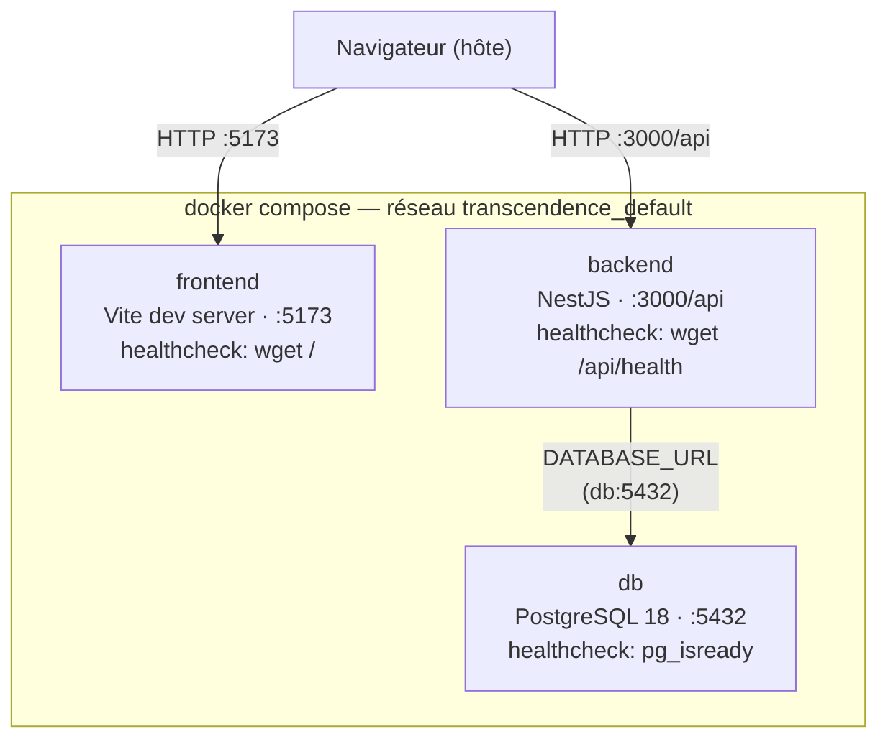
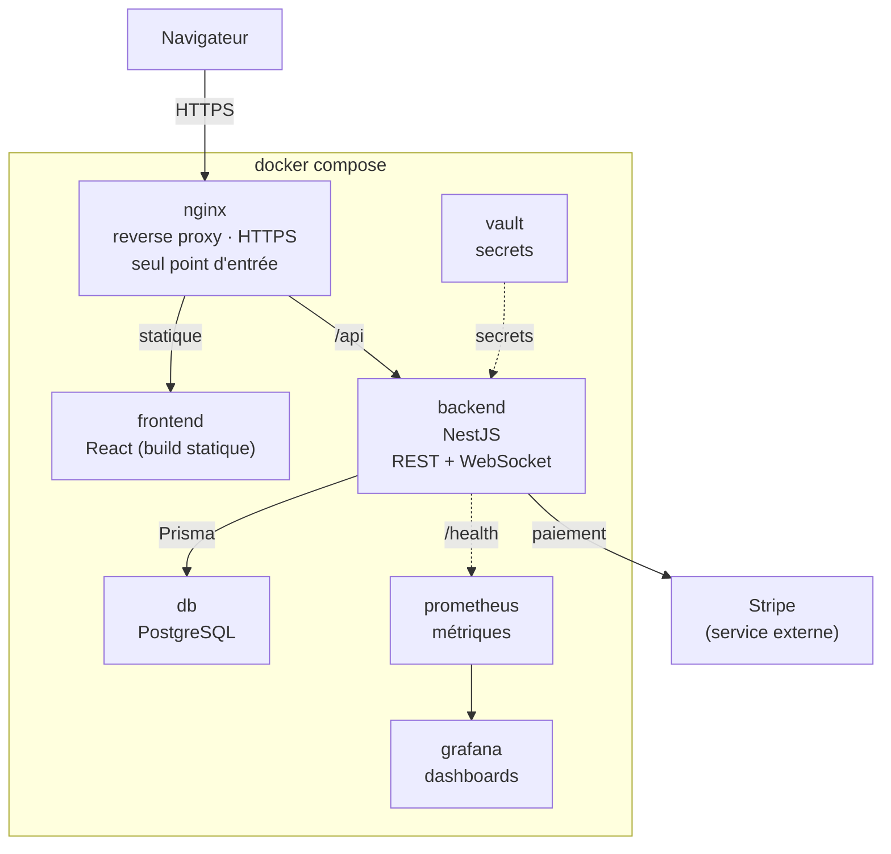

# Architecture de déploiement

## État actuel

État réel du `docker-compose.yml` actuel : 3 services, pas encore de `nginx`. Le navigateur parle directement au port du frontend et à celui du backend.

**Notes qui ne tiennent pas dans le dessin :**
- `backend` a un `depends_on: db: condition: service_healthy` — il attend que `db` soit vraiment prêt (pas juste démarré) avant de se lancer.
- Les trois ports (`5432`, `3000`, `5173`) ne sont publiés que sur `127.0.0.1` de la machine hôte, pas sur le réseau.
- Pas de `depends_on` sur `frontend` : il ne dépend ni de `backend` ni de `db` pour démarrer, c'est le navigateur qui appelle l'API, pas le conteneur.
- Aucun reverse proxy pour l'instant : deux ports différents exposés (`5173`, `3000`), au lieu d'une seule porte d'entrée. C'est précisément ce que le futur ticket `nginx` doit remplacer.

## Architecture cible

Ce que le `docker-compose.yml` doit devenir d'après `docs/architecture.md`, une fois tous les modules du périmètre DevOps faits (pas encore implémenté — `nginx`, `vault`, `prometheus`, `grafana` n'existent pas encore dans le repo).

Différences principales avec l'état actuel :
- Un seul point d'entrée (`nginx`, HTTPS) au lieu de deux ports publiés directement.
- Le frontend passe du serveur de dev Vite à un vrai build statique (`vite build`), servi par `nginx`.
- Le backend gagne une passerelle WebSocket (temps réel) en plus du REST.
- Trois nouveaux services : `vault` (secrets), `prometheus` + `grafana` (observabilité) — correspondent aux modules 5 et 6 du périmètre DevOps, pas encore commencés.
