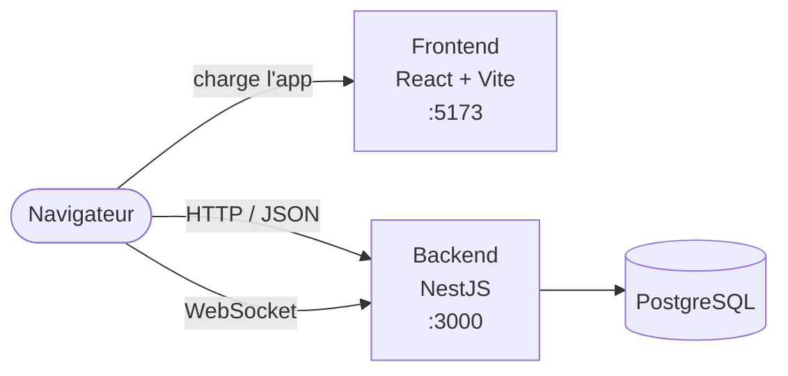
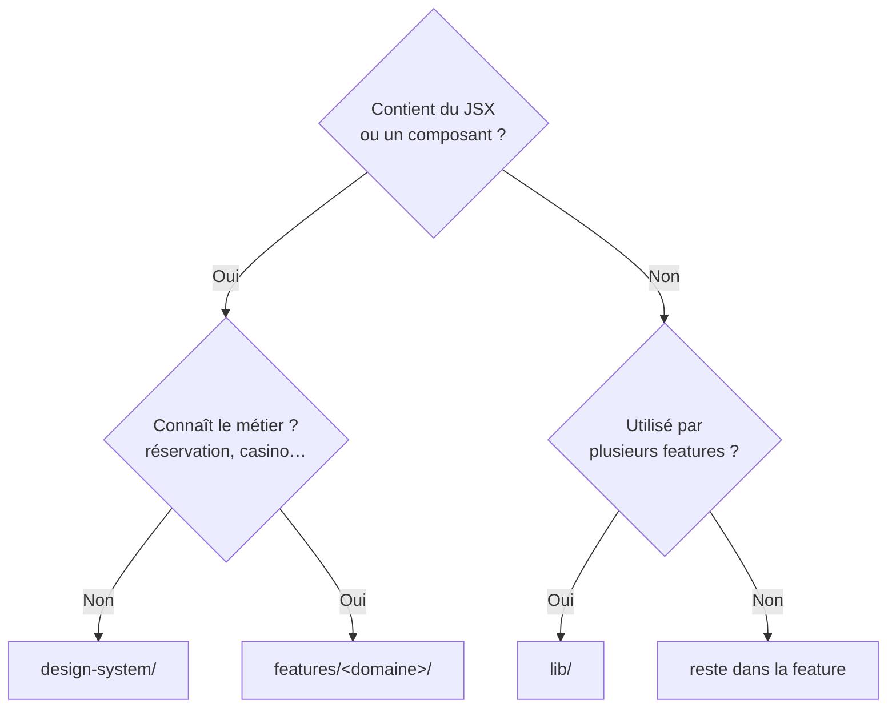
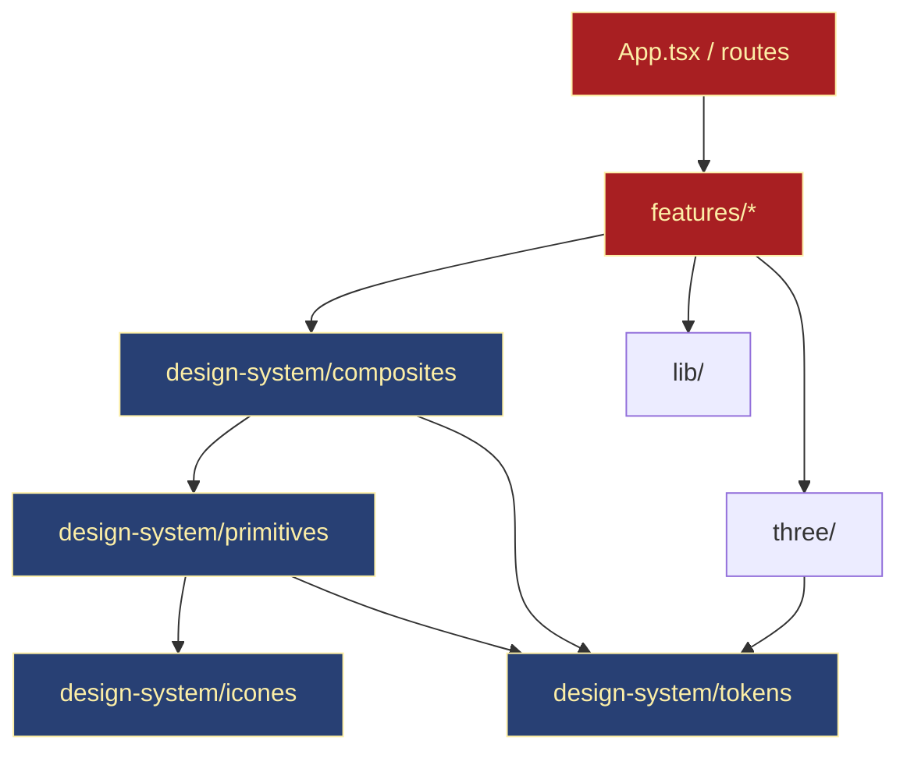
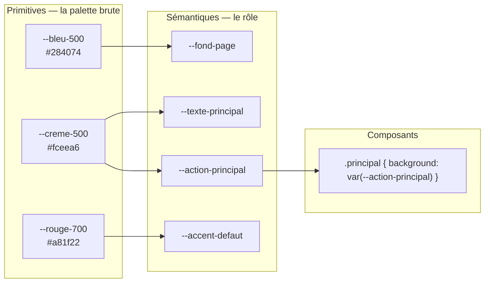
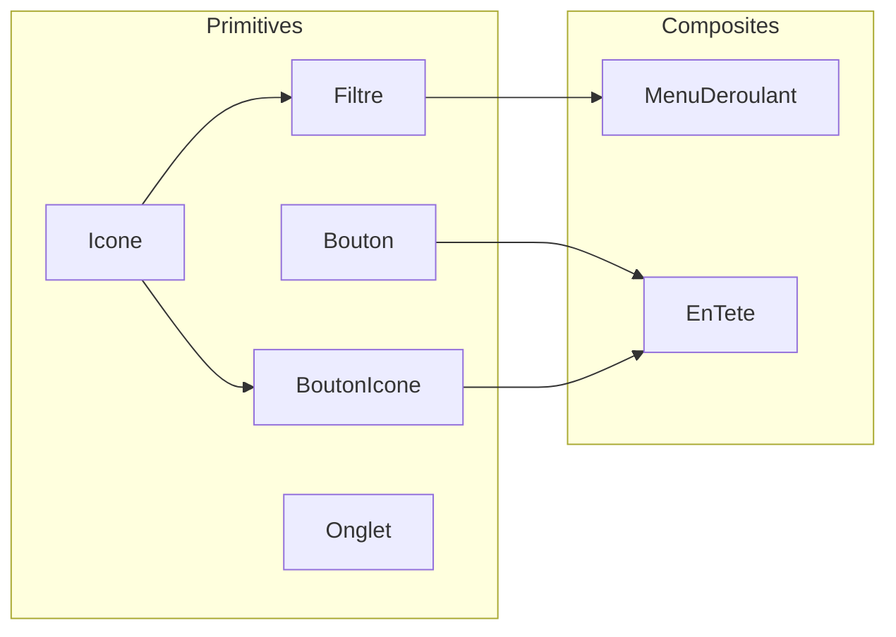
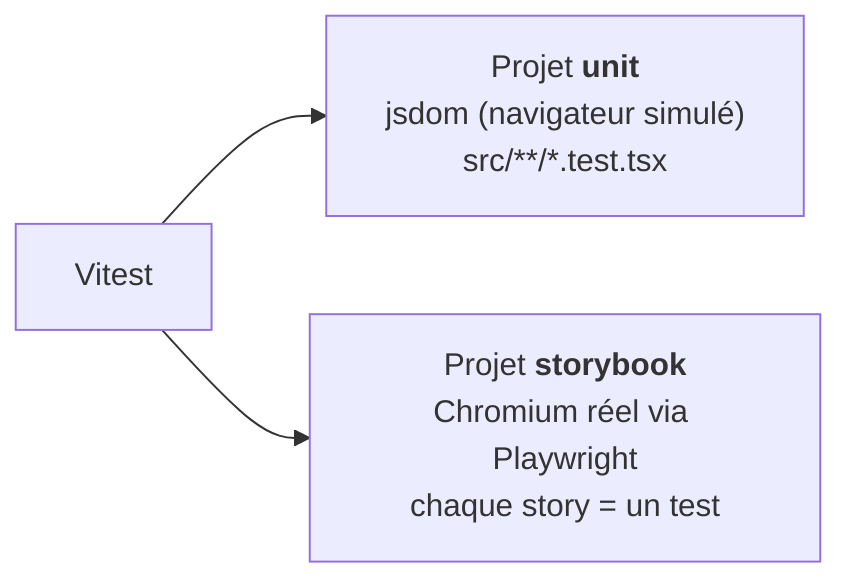
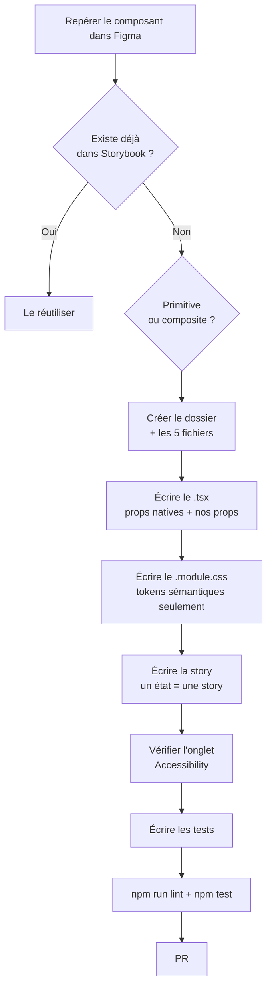

# Frontend — architecture et conventions

Ce document décrit **comment le frontend est organisé et pourquoi** : l'arborescence de `frontend/src`, le design system, les règles d'import, les conventions de code et de test. Rédigé avec l'aide d'une IA (Claude).

> [!NOTE]
> Pour **installer et lancer** le projet (nvm, `npm ci`, commandes), voir [`frontend/README.md`](../frontend/README.md).
> Pour **Docker**, voir [`docs/frontend-docker.md`](frontend-docker.md). Ce document-ci ne répète pas ces sujets.

## Sommaire

1. [Vue d'ensemble](#1-vue-densemble)
2. [Stack technique](#2-stack-technique)
3. [Arborescence](#3-arborescence)
4. [Les couches et le sens des imports](#4-les-couches-et-le-sens-des-imports)
5. [Le design system](#5-le-design-system)
6. [Anatomie d'un composant](#6-anatomie-dun-composant)
7. [Tests](#7-tests)
8. [Storybook](#8-storybook)
9. [Conventions de code](#9-conventions-de-code)
10. [Ajouter un composant pas à pas](#10-ajouter-un-composant-pas-à-pas)
11. [État actuel et reste à faire](#11-état-actuel-et-reste-à-faire)

---

## 1. Vue d'ensemble

Le frontend est une **application React monopage (SPA)** servie par Vite. Le navigateur charge une seule page HTML (`index.html`) et React construit toute l'interface en JavaScript. Le frontend ne contient aucune donnée métier : il **affiche** et **appelle l'API** du backend NestJS.



Point important : c'est **le navigateur** qui appelle le backend, pas le conteneur frontend. Le conteneur ne fait que servir les fichiers de l'application.

---

## 2. Stack technique

| Outil | Rôle | Où on le voit |
|---|---|---|
| **React 19** + **TypeScript** | L'interface et son typage | Tous les `.tsx` |
| **Vite 8** | Serveur de dev (hot-reload) et build | `vite.config.ts` |
| **CSS Modules** | Styles isolés par composant | Fichiers `*.module.css` |
| **React Router** | Pages et URL | À venir dans `features/` |
| **i18next** + **react-i18next** | Traductions | À venir dans `lib/` |
| **Three.js** + **React Three Fiber** + **Drei** | Table de poker en 3D | `src/three/` |
| **GSAP** | Animations de caméra | `src/three/` |
| **qrcode.react** | QR code de réservation | Primitive `QrCode` |
| **@fontsource** | Polices Monoton et Space Grotesk, hébergées localement | Import dans le point d'entrée |
| **Vitest** + **Testing Library** | Tests unitaires de composants | Fichiers `*.test.tsx` |
| **Storybook 10** | Catalogue visuel des composants, avec contrôle d'accessibilité | Fichiers `*.stories.tsx` |
| **Oxlint** | Linter | `.oxlintrc.json` |
| **Prettier** | Formatage | `.prettierrc` |

---

## 3. Arborescence

```text
frontend/
├── .storybook/
│   ├── main.ts              # où trouver les stories, addons
│   └── preview.tsx          # charge polices + tokens.css dans chaque story
├── public/                  # fichiers servis tels quels, sans passer par Vite
│   ├── images/
│   └── models/              # modèles 3D .glb
├── src/
│   ├── main.tsx             # point d'entrée : monte <App /> dans #root
│   ├── App.tsx              # composant racine (routes à venir)
│   ├── design-system/       # 🎨 l'interface réutilisable, sans métier
│   │   ├── tokens/
│   │   │   └── tokens.css   # couleurs, espacements, typo… (source : Figma)
│   │   ├── icones/          # composant <Icone> + tracés SVG
│   │   ├── primitives/      # briques de base : Bouton, Filtre, Onglet…
│   │   └── composites/      # assemblages de primitives : CarteTable, EnTete…
│   ├── features/            # 🧭 les écrans, un dossier par domaine
│   │   ├── auth/            # connexion, inscription
│   │   ├── account/         # profil, réglages
│   │   ├── booking/         # réservation, paiement
│   │   ├── lobby/           # choix du casino et de la table
│   │   └── table/           # vue d'une table
│   ├── lib/                 # 🔧 outils techniques partagés, sans JSX
│   └── three/               # 🎲 scène 3D (Three.js / R3F)
├── index.html
├── vite.config.ts           # Vite + config des deux projets de test
├── tsconfig*.json
├── vitest.setup.ts          # setup des tests unitaires
├── .oxlintrc.json
├── .prettierrc
└── .nvmrc                   # Node 24
```

### Rôle de chaque dossier de `src/`

| Dossier | Contient | Connaît le métier ? | Exemple |
|---|---|---|---|
| `design-system/` | Composants visuels génériques | ❌ Non | `<Bouton variante="accent">` |
| `features/` | Écrans, logique et appels d'un domaine | ✅ Oui | Le formulaire de connexion |
| `lib/` | Fonctions techniques partagées, **sans JSX** | ❌ Non | Client API, `formaterPrix()` |
| `three/` | Tout le code 3D | Un peu (la table) | Scène, caméra, chargement `.glb` |

### Que mettre dans `lib/` ?

`lib/` contient le code **utilisé par plusieurs features** qui n'est **pas un composant**. Contenu prévu :

- **Client API** : un wrapper autour de `fetch` qui connaît l'URL du backend, ajoute le token et convertit les erreurs HTTP.
- **Client WebSocket** : connexion temps réel (lobby, table, réservations).
- **i18n** : initialisation d'i18next.
- **Formateurs** : prix, dates, durées.
- **Validateurs** : e-mail, mot de passe.



> [!TIP]
> Ne mets pas une fonction dans `lib/` « au cas où ». Elle naît dans la feature qui en a besoin, et elle ne monte dans `lib/` que le jour où une **deuxième** feature en a besoin.

---

## 4. Les couches et le sens des imports

Les dossiers forment des **couches**. Une couche peut importer celles du dessous, **jamais celles du dessus**.



**Règles :**

- ✅ Une feature importe des composites, des primitives et `lib/`.
- ✅ Un composite importe des primitives.
- ❌ Une primitive n'importe **jamais** un composite ni une feature.
- ❌ Le design system n'importe **jamais** `features/` ni `lib/` : il doit rester utilisable sans le métier.
- ❌ Une feature n'importe pas une autre feature. Si deux features partagent quelque chose, ce quelque chose monte dans `lib/` ou dans le design system.

**Pourquoi ?** Si `Bouton` importait du code de `booking`, toucher à la réservation pourrait casser tous les boutons de l'app. Les dépendances à sens unique empêchent ces effets de bord.

---

## 5. Le design system

### 5.1 Les tokens

Les tokens sont des **variables CSS** déclarées dans [`src/design-system/tokens/tokens.css`](../frontend/src/design-system/tokens/tokens.css). Ils viennent des variables du fichier Figma **« Floor »**, thème « Bandes rétro ».

> [!IMPORTANT]
> **Figma est la source de vérité.** On ne modifie pas `tokens.css` à la main. Si une valeur change, on la change dans Figma, puis on régénère le fichier.

Les tokens sont rangés en **deux niveaux** :



> [!WARNING]
> **Règle d'or : dans un composant, on n'utilise QUE des tokens sémantiques.**
> ❌ `color: var(--creme-500);` · ❌ `color: #fceea6;` · ✅ `color: var(--texte-principal);`
>
> Si demain le crème change de teinte, ou si on ajoute un thème, seules les correspondances sémantique → primitive changent. Aucun composant n'est à retoucher.

**Familles de tokens disponibles :**

| Famille | Préfixe | Exemples |
|---|---|---|
| Fonds | `--fond-` | `page`, `surface`, `profond`, `inverse`, `voile` |
| Textes | `--texte-` | `principal`, `secondaire`, `inverse`, `accent`, `erreur` |
| Bordures | `--bordure-` | `forte`, `defaut`, `subtile`, `erreur` |
| Actions | `--action-principal-*`, `--accent-*` | `defaut`, `survol`, `presse` |
| Contrôles | `--controle-`, `--etat-` | `piste`, `focus` |
| Table 3D | `--table-`, `--chaise-` | `tapis`, `libre`, `occupee`, `selection` |
| Espacements | `--espace-` | `4`, `8`, `12`, `16`, `20`, `24`, `32`, `40` |
| Rayons | `--rayon-` | `m`, `l`, `pastille` |
| Ombres et lueurs | `--ombre-`, `--lueur-`, `--anneau-focus` | `carte`, `neon` |
| Tailles | `--hauteur-`, `--icone-` | `bouton`, `filtre`, `champ`, `s`, `m`, `l` |
| Animations | `--duree-`, `--courbe-` | `survol`, `fenetre`, `sortie` |

> [!NOTE]
> `--point-rupture: 768px` est là **pour information** : une media query ne peut pas lire une variable CSS. Dans les `@media`, écris directement `768px`.

### 5.2 La typographie

La typo n'est pas faite avec des tokens isolés mais avec des **classes globales**, une par style Figma, définies dans `tokens.css`.

| Police | Usage | Classes |
|---|---|---|
| **Monoton** | Logo et grands chiffres, **≥ 36 px uniquement** | `typo-logo-xl`, `typo-logo-l`, `typo-logo-m`, `typo-affiche-titre` |
| **Space Grotesk** | Toute l'interface | `typo-titre-1/2/3`, `typo-texte-base`, `typo-texte-fort`, `typo-texte-petit`, `typo-libelle`, `typo-libelle-fort`, `typo-legende`, `typo-legende-forte`, `typo-surtitre` |

Deux façons de l'appliquer :

```tsx
// 1. Dans le JSX
<h1 className="typo-titre-1">Mes réservations</h1>
```

```css
/* 2. Dans un .module.css */
.titre {
  composes: typo-titre-2 from global;
}
```

### 5.3 Les icônes

Les icônes sont des **tracés SVG** stockés dans `icones/icones.data.ts` et affichés par le composant `<Icone>`.

```tsx
<Icone nom="chevron-bas" taille={16} />               // décorative : aria-hidden
<Icone nom="fermer" taille={24} libelle="Fermer" />    // porteuse de sens : role="img"
```

- `nom` est typé (`NomIcone`) : TypeScript refuse un nom qui n'existe pas.
- Tailles autorisées : `16`, `20`, `24`, qui correspondent à `--icone-s/m/l`.
- Sans `libelle`, l'icône est **cachée aux lecteurs d'écran**. C'est le bon choix quand un texte voisin dit déjà la même chose.
- Pour ajouter une icône : ajoute une entrée `nom: "tracé SVG"` dans `icones.data.ts`, dessinée sur une grille de 24 × 24 et en trait (`stroke`).

### 5.4 Primitives et composites



*Les liens entre composites et primitives sont un exemple de composition attendue : les composites ne sont pas encore codés.*

- Une **primitive** est la plus petite brique utile. Elle ne contient pas d'autre composant du design system, sauf `Icone`.
- Un **composite** assemble plusieurs primitives. Il reste générique : `CarteTable` affiche une table qu'on lui passe en props, il ne va pas la chercher lui-même dans l'API.

---

## 6. Anatomie d'un composant

Chaque composant du design system vit dans son propre dossier, avec **5 fichiers** :

```text
primitives/Filtre/
├── Filtre.tsx           # le composant
├── Filtre.module.css    # son style, uniquement avec des tokens
├── Filtre.stories.tsx   # ses variantes dans Storybook
├── Filtre.test.tsx      # ses tests
└── index.ts             # export public : export { Filtre } from './Filtre';
```

### Le modèle à suivre

```tsx
import type { ButtonHTMLAttributes } from 'react';
import styles from './Bouton.module.css';

// 1. Les props = tous les attributs natifs du <button> + nos props à nous
type BoutonProps = ButtonHTMLAttributes<HTMLButtonElement> & {
  variante?: 'principal' | 'secondaire' | 'accent';
};

export function Bouton(props: BoutonProps) {
  // 2. On sort nos props ; tout le reste part dans "reste"
  const { variante = 'principal', className, ...reste } = props;

  return (
    <button
      {...reste} // 3. onClick, disabled, aria-*… sont transmis tels quels
      // 4. Nos classes d'abord, puis celle de l'appelant
      className={`${styles.bouton} ${styles[variante]} typo-texte-fort ${className ?? ''}`}
    />
  );
}
```

**Les quatre réflexes :**

1. **Étendre les attributs natifs** (`ButtonHTMLAttributes`, `InputHTMLAttributes`…). Le composant accepte alors tout ce qu'accepte la balise HTML, sans qu'on ait à tout redéclarer.
2. **Des valeurs par défaut dans la déstructuration** (`variante = 'principal'`).
3. **`{...reste}`** pour transmettre le reste des props. Sa **position** compte : une prop écrite *après* `{...reste}` gagne toujours sur celle de l'appelant. Pour les attributs d'accessibilité qui ne doivent pas être écrasés (`role`, `aria-selected`…), place-les **après** `{...reste}`.
4. **Fusionner `className`** au lieu de la remplacer, pour qu'une feature puisse ajouter une marge sans casser le style du composant.

### Les props en français

Le projet nomme ses props et ses variantes en français, comme Figma : `variante`, `actif`, `ouvert`, `libelle`, `taille`. Garde cette cohérence.

### Accessibilité

C'est un critère de « fini », pas un bonus :

- **La bonne balise d'abord** : `<button>` pour une action, `<a>` pour une navigation, `<input type="radio">` pour un choix unique. Une `<div onClick>` est inaccessible au clavier.
- **Un nom accessible** : un `BoutonIcone` n'a pas de texte visible, d'où sa prop `libelle` obligatoire, qui devient `aria-label`.
- **Les états ARIA** : `aria-pressed` pour un bouton à bascule, `aria-expanded` et `aria-haspopup` pour un menu, `aria-selected` et `role="tab"` pour un onglet.
- **Le focus** : l'anneau global `:focus-visible` (`--anneau-focus`) est déjà défini dans `tokens.css`. Ne le supprime pas.
- **Le contraste** : `--texte-accent` (rouge) seulement en texte de **24 px ou plus**, ou sur fond crème.

L'addon **a11y** de Storybook signale les problèmes de contraste et d'ARIA dans l'onglet « Accessibility » de chaque story.

---

## 7. Tests

Deux « projets » Vitest sont configurés dans `vite.config.ts` :



| Commande | Ce qu'elle lance |
|---|---|
| `npm test` | Les tests **unit** uniquement, en mode watch |
| `npx vitest --project storybook` | Le rendu de chaque story dans un vrai Chromium |
| `npx vitest` | Les deux projets |

### Écrire un test

On teste **ce que voit l'utilisateur**, pas l'implémentation :

```tsx
import { describe, it, expect, vi } from 'vitest';
import { render, screen } from '@testing-library/react';
import userEvent from '@testing-library/user-event';
import { Bouton } from './Bouton';

describe('Bouton', () => {
  it('appelle onClick au clic', async () => {
    const auClic = vi.fn();
    render(<Bouton onClick={auClic}>Jouer</Bouton>);

    await userEvent.click(screen.getByRole('button', { name: 'Jouer' }));

    expect(auClic).toHaveBeenCalledTimes(1);
  });
});
```

**Conventions :**

- **Chercher par rôle** (`getByRole('button', { name: … })`) plutôt que par classe ou `data-testid`. Si le test ne trouve pas l'élément par son rôle, un lecteur d'écran non plus : le test vérifie l'accessibilité au passage.
- **`userEvent`** plutôt que `fireEvent` : il simule une vraie interaction (survol, focus, clic).
- **Noms de tests en français**, sous forme de phrase : `it("n'appelle pas onClick quand il est désactivé")`.
- **Checklist minimale** pour une primitive :
  - elle affiche son contenu ;
  - elle réagit à l'interaction ;
  - elle ne réagit pas quand elle est `disabled` ;
  - elle fusionne `className` ;
  - chaque variante ou état produit les bons attributs ARIA.
- Les noms de classes CSS Modules peuvent être transformés. Pour vérifier une classe de module, utilise `className.toMatch(/actif/)` plutôt que `toHaveClass('actif')`.

`vitest.setup.ts` charge les matchers `jest-dom` (`toBeInTheDocument`, `toHaveAttribute`…) et nettoie le DOM après chaque test.

---

## 8. Storybook

```bash
npm run storybook   # http://localhost:6006
```

Storybook affiche chaque composant **isolé**, avec ses variantes. C'est la **documentation vivante** du design system : avant de créer un composant, regarde dans Storybook s'il n'existe pas déjà.

- `.storybook/preview.tsx` charge les **polices** et **`tokens.css`** : les stories ont exactement le rendu de l'app.
- Le titre d'une story suit l'arborescence : `title: 'primitives/Filtre'`.
- Une story par état visuel important : `Actif`, `Inactif`, `Desactive`, `Groupe`…
- Pour une action, utilise `fn()` de `storybook/test` : les clics apparaissent alors dans l'onglet « Actions ».

```tsx
import type { Meta, StoryObj } from '@storybook/react-vite';
import { fn } from 'storybook/test';
import { Onglet } from './Onglet';

const meta: Meta<typeof Onglet> = {
  title: 'primitives/Onglet',
  component: Onglet,
  args: { children: 'À venir', onClick: fn() },
};
export default meta;

export const Actif: StoryObj<typeof Onglet> = { args: { actif: true } };
```

---

## 9. Conventions de code

| Sujet | Règle |
|---|---|
| **Langue** | Noms de composants, props, variantes et tests en **français** (`Bouton`, `variante`, `actif`). Mots-clés et API techniques restent en anglais. |
| **Nommage** | Composants et dossiers en `PascalCase` (`BoutonIcone/`). Fonctions et variables en `camelCase`. Classes CSS en `camelCase` (`.boutonIcone`). |
| **Exports** | Exports **nommés** (`export function Bouton`), pas de `export default` dans le design system. |
| **Imports de types** | `import type { … }` (exigé par `verbatimModuleSyntax`). |
| **Styles** | CSS Modules uniquement, et uniquement des **tokens sémantiques**. Pas de valeur en dur, pas de style inline. |
| **Formatage** | Prettier : guillemets simples, virgules finales. |
| **Lint** | `npm run lint` avant chaque commit. |
| **TypeScript** | `noUnusedLocals` et `noUnusedParameters` sont actifs : une variable inutilisée casse le build. |
| **Dépendances** | Voir [`frontend/README.md`](../frontend/README.md#-ajouter-une-dépendance) : on prévient l'équipe, puis `npm ci`, jamais `npm install`. |

---

## 10. Ajouter un composant pas à pas



**Checklist avant la PR :**

- [ ] Les 5 fichiers existent, et `index.ts` exporte le composant.
- [ ] Aucune couleur ni taille en dur dans le CSS, aucun token primitif.
- [ ] Les props étendent les attributs HTML natifs, et `className` est fusionnée.
- [ ] La story couvre chaque variante ou état.
- [ ] L'onglet « Accessibility » de Storybook ne remonte aucune violation.
- [ ] `npm run lint` et `npm test` passent.

---

## 11. État actuel et reste à faire

### Composants

| Composant | Couche | État |
|---|---|---|
| `Icone` | icones | ✅ Fait |
| `Bandes` | primitive | ✅ Fait |
| `Bouton` | primitive | ✅ Fait |
| `BoutonIcone` | primitive | ✅ Fait |
| `BoutonRadio` | primitive | ✅ Fait |
| `Filtre` | primitive | 🚧 En cours (CSS incomplet) |
| `Logo` | primitive | ✅ Fait |
| `Onglet` | primitive | ✅ Fait |
| `Avatar`, `Badge`, `ChampSaisie`, `Interrupteur`, `Notification`, `QrCode`, `Slider` | primitive | ⏳ À faire |
| `CartePaiement`, `CarteReservation`, `CarteTable`, `EnTete`, `Fenetre`, `LigneInfo`, `LigneMenu`, `MenuDeroulant`, `NavigationCompte`, `Option` | composite | ⏳ À faire |

### Points connus à traiter

- **L'app n'utilise pas encore le design system.** `main.tsx` importe `index.css`, et `App.tsx` et `App.css` sont encore le **template de démarrage de Vite**. `tokens.css` et les polices `@fontsource` ne sont chargés **que dans Storybook** (`.storybook/preview.tsx`). Quand on branchera les vrais écrans, il faudra importer ces fichiers dans `main.tsx` et retirer le template.
- **`src/stories/`** contient les exemples générés par Storybook à l'installation (`Button`, `Header`, `Page`). Ils ne font pas partie du projet et peuvent être supprimés.
- **`features/`, `lib/` et `three/` sont vides** (`.gitkeep`) : ils seront remplis avec les écrans, le client API et la scène 3D.
- **Pas encore de variable `VITE_API_URL`** pour l'URL du backend : à ajouter avec le client API dans `lib/`.
- **i18n** : `public/locales/` est prévu dans [`architecture.md`](architecture.md) mais pas encore créé.
- **`tokens.css`** cite un fichier `tokens3d.ts` (couleurs de la table pour les matériaux Three.js) qui n'existe pas encore.
- **Autocomplétion des tokens dans VS Code** : par défaut, VS Code ne propose les `var(--…)` que s'ils sont déclarés dans le fichier ouvert. Installe une extension comme *CSS Var Complete* pour qu'il indexe `tokens.css`.
