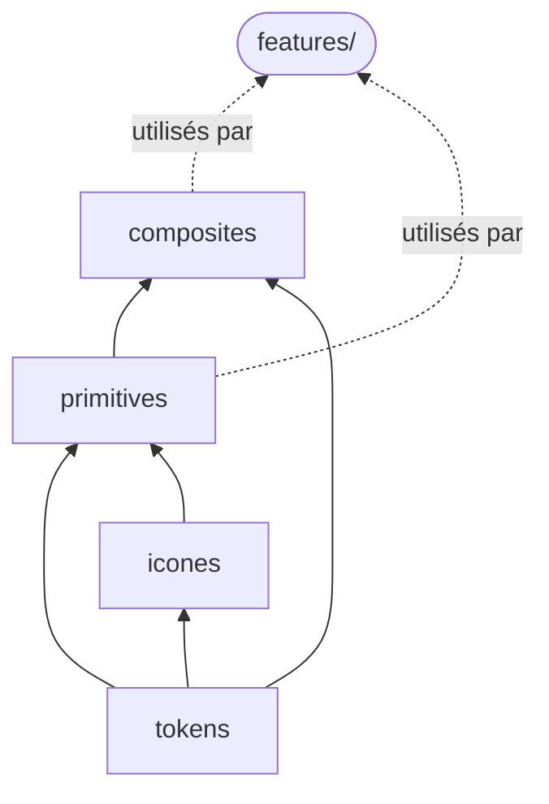

# `design-system/`

> **Les briques visuelles réutilisables de l'interface, sans aucune logique métier.**
> Un composant d'ici ne sait pas ce qu'est une réservation, un casino ou un utilisateur : il affiche ce qu'on lui donne en props.

Vue d'ensemble du frontend : [`docs/frontend.md`](../../../docs/frontend.md).

## Contenu

```text
design-system/
├── tokens/
│   └── tokens.css     # variables CSS + classes de typographie (source : Figma « Floor »)
├── icones/            # <Icone nom="…" /> + tracés SVG
├── primitives/        # les plus petites briques : Bouton, Filtre, Onglet…
└── composites/        # assemblages de primitives : CarteTable, EnTete, Fenetre…
```



| Sous-dossier | Rôle | Peut importer |
|---|---|---|
| `tokens/` | Couleurs, espacements, rayons, ombres, durées, typographie | Rien |
| `icones/` | Composant `Icone` et dictionnaire des tracés SVG | Rien |
| `primitives/` | Briques autonomes (`Bouton`, `Filtre`, `BoutonRadio`…) | `tokens`, `icones` |
| `composites/` | Composants faits de plusieurs primitives (`MenuDeroulant`, `CarteTable`…) | `tokens`, `icones`, `primitives` |

> [!WARNING]
> Le design system n'importe **jamais** `features/`, `lib/` ni `three/`. S'il le faisait, il ne serait plus réutilisable et un changement métier pourrait casser l'interface entière.

## Les tokens

- **Figma est la source de vérité** : on ne modifie pas `tokens.css` à la main.
- Deux niveaux de tokens :
  - les **primitifs** (`--bleu-500`, `--creme-500`) : la palette brute, **interdite dans les composants** ;
  - les **sémantiques** (`--fond-page`, `--texte-principal`, `--action-principal`) : les **seuls** à utiliser.
- La typographie passe par des **classes globales** : `typo-titre-1`, `typo-texte-fort`, `typo-libelle`…

```css
/* ✅ */ color: var(--texte-principal);
/* ❌ */ color: var(--creme-500);
/* ❌ */ color: #fceea6;
```

## Primitive ou composite ?

- **Primitive** : elle ne contient aucun autre composant du design system, sauf `Icone`. Exemples : `Bouton`, `Onglet`, `Badge`.
- **Composite** : elle assemble plusieurs primitives. Exemple : un `MenuDeroulant` composé d'un `Filtre` et de `LigneMenu`.

Dans les deux cas, le composant reste **générique** : `CarteTable` reçoit les infos de la table en props, elle ne les cherche pas elle-même dans l'API.

## Un composant = 5 fichiers

```text
primitives/Bouton/
├── Bouton.tsx           # le composant
├── Bouton.module.css    # son style, avec des tokens sémantiques uniquement
├── Bouton.stories.tsx   # ses variantes dans Storybook
├── Bouton.test.tsx      # ses tests
└── index.ts             # export { Bouton } from './Bouton';
```

**Les règles de chaque composant :**
- Ses props **étendent les attributs HTML natifs** (`ButtonHTMLAttributes<…>`, etc.).
- Il transmet le reste des props avec `{...reste}`.
- Il **fusionne** `className` avec ses propres classes au lieu de la remplacer.
- Il utilise la **bonne balise HTML** et les bons attributs ARIA (rôle, nom accessible, états).
- Ses props et variantes sont nommées **en français** : `variante`, `actif`, `libelle`.

Détails et modèle commenté : [`docs/frontend.md` § 6](../../../docs/frontend.md#6-anatomie-dun-composant).

## État

| | Faits | À faire |
|---|---|---|
| **icones** | `Icone` | — |
| **primitives** | `Bandes`, `Bouton`, `BoutonIcone`, `BoutonRadio`, `Logo`, `Onglet`, `Filtre` (en cours) | `Avatar`, `Badge`, `ChampSaisie`, `Interrupteur`, `Notification`, `QrCode`, `Slider` |
| **composites** | — | `CartePaiement`, `CarteReservation`, `CarteTable`, `EnTete`, `Fenetre`, `LigneInfo`, `LigneMenu`, `MenuDeroulant`, `NavigationCompte`, `Option` |

Pour voir les composants existants : `npm run storybook` → http://localhost:6006
