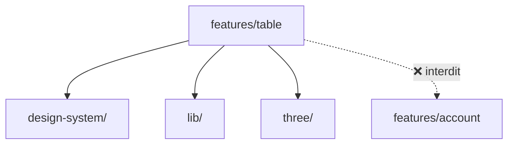

# `features/`

> **Les écrans de l'application, regroupés par domaine métier.**
> C'est ici que l'interface rencontre les données : une feature assemble les composants du design system, appelle l'API et gère l'état de ses écrans.

Vue d'ensemble du frontend : [`docs/frontend.md`](../../../docs/frontend.md).

> [!NOTE]
> **Statut : vide pour l'instant.** Les dossiers ne contiennent qu'un `.gitkeep`. Ce document décrit ce qui est **prévu**.

## Les domaines

| Dossier | Domaine | Écrans prévus | Module backend correspondant |
|---|---|---|---|
| `auth/` | Authentification | Connexion, inscription, déconnexion | `auth/`, `users/` |
| `account/` | Compte de l'utilisateur | Profil, réglages, mes réservations, confirmation et QR code | `users/`, `reservations/` |
| `lobby/` | Accueil et exploration | Liste des casinos et des tables, filtres | `casinos/`, `tables/` |
| `table/` | Une table et sa réservation | Vue de la table (3D), choix d'une place, buy-in, paiement : tout le parcours qui se passe par-dessus la scène 3D | `tables/` (tables et places), `reservations/` |

Le découpage suit celui du backend (voir [`docs/architecture.md`](../../../docs/architecture.md)). Exception : la réservation. Côté backend, c'est le module `reservations/`. Côté front, on **réserve** dans `table/` (le parcours se déroule par-dessus la scène 3D, sans changer de page) et on **consulte** ses réservations dans `account/`. À la fin du paiement, `table/` navigue vers la page de la réservation dans `account/` : aucune des deux features n'importe l'autre.

## Ce qu'une feature a le droit d'importer



- ✅ Le design system (primitives, composites, tokens).
- ✅ `lib/` : client API, i18n, formateurs.
- ✅ `three/` : la scène 3D, surtout pour `table/` et `lobby/`.
- ❌ **Une autre feature.** Si `table` et `account` ont besoin de la même chose, cette chose monte dans `lib/` (si c'est du code sans JSX) ou dans le design system (si c'est un composant générique).

**Pourquoi ?** Pour que chaque domaine puisse évoluer seul. Si `table` dépendait d'un composant interne d'`account`, le renommer casserait la réservation.

## Organisation interne d'une feature (proposition)

Une feature commence petite. On ne crée les sous-dossiers que quand ils deviennent utiles :

```text
features/table/
├── pages/            # les écrans reliés à une route : TablePage.tsx…
├── components/       # composants propres à ce domaine (connaissent le métier)
├── hooks/            # logique React réutilisée dans le domaine : useBuyIn()…
├── api.ts            # appels au backend pour ce domaine, via le client de lib/
├── types.ts          # types du domaine : EtapeTable, BuyIn…
└── index.ts          # ce que la feature expose à App.tsx (ses routes)
```

> [!TIP]
> **Composant de feature ou du design system ?** Si on peut l'utiliser ailleurs en changeant seulement ses props, il va dans le design system. S'il connaît le métier (une `Reservation`, un statut de paiement…), il reste dans la feature.

## Ce qu'on ne met pas ici

- Des composants visuels génériques → `design-system/`
- Le client HTTP, les formateurs, l'i18n → `lib/`
- La scène Three.js, les modèles 3D → `three/`
