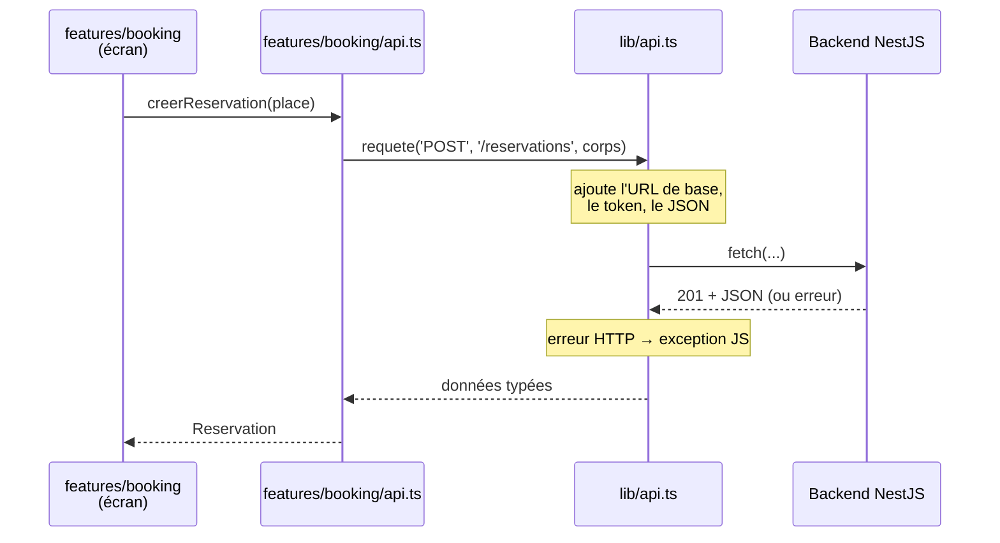
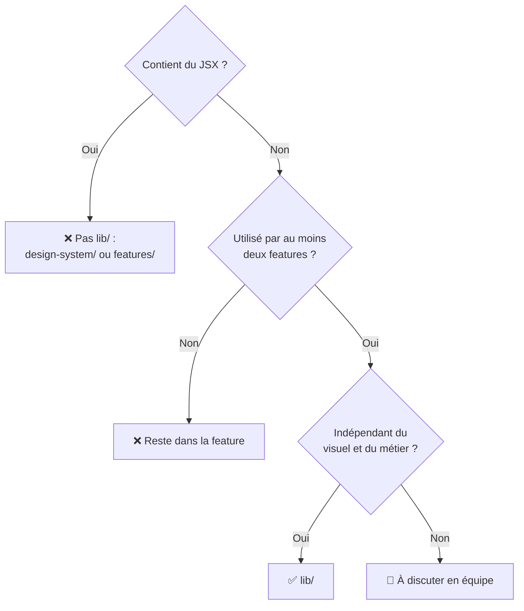

# `lib/`

> **Les outils techniques partagés entre plusieurs features. Pas de JSX, pas de composant, pas d'écran.**
> Du code qui pourrait fonctionner dans un autre projet : parler au backend, traduire, formater une date…

Vue d'ensemble du frontend : [`docs/frontend.md`](../../../docs/frontend.md).

> [!NOTE]
> **Statut : vide pour l'instant.** Le dossier ne contient qu'un `.gitkeep`. Ce document décrit ce qui est **prévu**.

## Contenu prévu

| Fichier / dossier | Rôle | Utilisé par |
|---|---|---|
| `api.ts` | Client HTTP : un wrapper autour de `fetch` qui connaît l'URL du backend, ajoute le token d'authentification et convertit les erreurs HTTP en erreurs JS | Toutes les features |
| `socket.ts` | Client WebSocket : connexion, reconnexion, messages typés (mises à jour des places et des réservations en temps réel) | `lobby`, `table`, `booking` |
| `i18n.ts` | Initialisation d'i18next et choix de la langue | `main.tsx`, toutes les features |
| `formatage.ts` | Fonctions pures : `formaterPrix(centimes)`, `formaterDate(date)`, durées… | `booking`, `account`… |
| `validation.ts` | Vérifications de formulaires : e-mail, mot de passe… | `auth`, `account` |

Les noms sont indicatifs : ils seront fixés au moment d'écrire le code.

## Comment ça s'articule

- **`lib/api.ts`** sait *comment* parler au backend, mais ne connaît aucun endpoint métier.
- **`features/<domaine>/api.ts`** sait *quoi* demander (`/reservations`), mais délègue le *comment* à `lib/`.

Si demain l'URL du backend ou la gestion du token change, on modifie un seul fichier.

## La règle pour savoir si un fichier va ici

> [!TIP]
> Ne crée pas de fonction dans `lib/` « au cas où ». Une fonction naît dans la feature qui en a besoin, et elle ne monte ici que le jour où une **deuxième** feature en a besoin.

## Règles

- **Aucune dépendance vers `features/`** : `lib/` est en dessous de `features/` dans les couches, il ne peut pas les importer.
- **De préférence des fonctions pures** (même entrée → même sortie, aucun effet de bord). Elles se testent sans navigateur ni serveur.
- **Un fichier de test à côté** : `formatage.ts` → `formatage.test.ts`.
- **Configuration par variables d'environnement Vite** : l'URL du backend viendra d'une variable `VITE_API_URL` (lue avec `import.meta.env.VITE_API_URL`), pas d'une URL écrite en dur.
