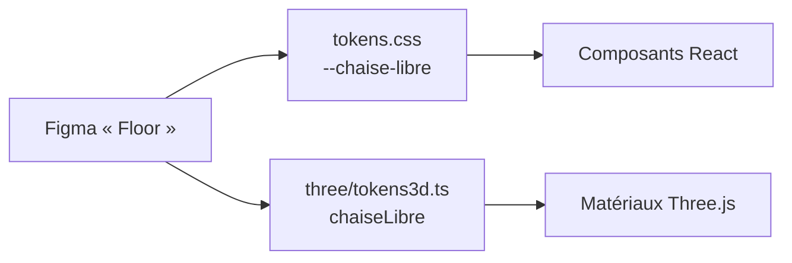
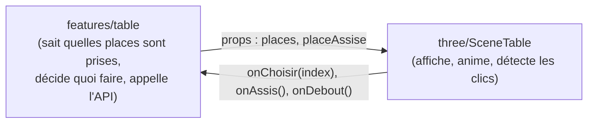

# `three/`

> **Tout le code 3D de l'application : la table de poker, les chaises, la caméra et ses animations.**
> Isolé dans son propre dossier parce que c'est un domaine technique à part, avec ses propres outils et son propre mode de pensée (scène, matériaux, boucle de rendu).

Vue d'ensemble du frontend : [`docs/frontend.md`](../../../docs/frontend.md).

## Les outils

| Bibliothèque | Rôle |
|---|---|
| **Three.js** | Le moteur 3D : géométries, matériaux, lumières, rendu WebGL |
| **React Three Fiber (R3F)** | Écrire une scène Three.js en JSX : `<Canvas>`, `<ambientLight>`, `<primitive>`… React gère la création et la destruction des objets 3D |
| **Drei** | Aides prêtes à l'emploi pour R3F : `useGLTF` (charger le modèle), `PerspectiveCamera`, `useCursor` |
| **GSAP** | L'animation de la caméra qui va s'asseoir à la place choisie |

## Le modèle : `public/models/floor.glb`

Exporté depuis Blender (`jeton_floor.blend`). Les noms des objets servent de contrat avec le code :

| Objet | Rôle |
|---|---|
| `Seat_01` … `Seat_09` | Les chaises. `Seat_01` en bas à droite, `Seat_05` en haut, même ordre que `VueTable` et que `seatNumber` côté API |
| `Seat_01_POV` … `Seat_09_POV` | Le point de vue d'un joueur assis à cette place (position et orientation de la caméra) |
| `Table_Felt`, `Table_Rail`, `Table_Line`… | La table |
| Matériau `Floor_Chaise` | Le tissu des chaises, recoloré selon l'état de la place |

Les noms ne sont écrits qu'à un endroit : [`modele.ts`](modele.ts) (`nomPlace(4)` → `"Seat_05"`). Si on renomme un objet dans Blender, c'est le seul fichier à changer.

> [!WARNING]
> **Pièges de l'export glTF**
> - Blender a l'axe Z vers le haut, glTF / Three.js l'axe Y : une position Blender `(x, y, z)` devient `(x, z, −y)`.
> - Un *empty* (`Seat_XX_POV`) regarde vers son −Y local, une caméra vers son −Z : on corrige par une rotation de −90° autour de X (voir `vueAssise` dans [`vues.ts`](vues.ts)).
> - Le glb ne contient ni caméra ni lumière : elles sont recréées dans le code.

## Les fichiers

```text
three/
├── index.ts           # ce que les features importent : SceneTable, EtatChaise
├── SceneTable.tsx     # <Canvas> R3F : lumières, table, caméra
├── Table.tsx          # le modèle (useGLTF) : couleur des chaises, survol, clic
├── CameraTable.tsx    # la caméra : vue du dessus, puis animation GSAP jusqu'au siège
├── vues.ts            # calcul des vues : dessus, dessus tournée, assise
├── cadrage.ts         # hauteur de caméra pour que la table tienne à l'écran
├── modele.ts          # lien avec les noms du glb : Seat_XX, recherche de la place cliquée
├── tokens3d.ts        # couleurs, durées et réglages caméra pour Three.js
└── SceneTable.stories.tsx
```

### Pourquoi un `tokens3d.ts` ?

Three.js ne lit pas le CSS : un matériau attend une couleur JavaScript (`'#284074'`), pas `var(--table-tapis)`. `tokens3d.ts` reprend **les mêmes valeurs** que `tokens.css` (`--chaise-libre`, `--chaise-occupee`, `--chaise-selection`…). Si une couleur change dans Figma, il faut mettre à jour **les deux fichiers**.



`tokens3d.ts` contient aussi les réglages repris de Blender : l'objectif des caméras (`Cam_Top` 28 mm, `Cam_POV_Render` 18 mm) et les durées de l'animation (`durees3D`).

## Frontière avec `features/`



- `three/` **affiche**, **anime** et **remonte les interactions**.
- `features/table` **décide** : quelles places sont libres, laquelle est choisie, quand s'asseoir, ce qui s'affiche ensuite.

C'est la même idée que le design system : la scène 3D reçoit ses données en props et ne va jamais chercher elle-même dans l'API.

### Les props de `SceneTable`

| Prop | Rôle |
|---|---|
| `places: EtatChaise[]` | État des 9 places, dans l'ordre `Seat_01` → `Seat_09` : `'libre'`, `'occupee'` ou `'selection'` |
| `onChoisir(index)` | Clic sur une place **libre** (les autres ne réagissent pas) |
| `placeAssise` | `null` = vue du dessus. Un index = la caméra va s'asseoir à cette place. Repasser à `null` la fait remonter (animation jouée à l'envers) |
| `onAssis()` / `onDebout()` | Appelés à la **fin** de l'animation : la page peut alors afficher l'étape suivante |

Le `<Canvas>` est **transparent** : c'est la page qui choisit le fond (`--fond-page` vue du dessus, `--fond-profond` une fois assis). Il prend la taille de son parent, qui doit donc avoir une hauteur.

## La caméra

1. **Vue du dessus** : hauteur calculée par `hauteurPourCadrer` pour que toute la table tienne à l'écran, quelle que soit sa forme (écran large, mobile).
2. **Rotation** (`durees3D.rotationVersChaise`) : la table tourne pour amener la chaise choisie en bas de l'écran.
3. **Descente** (`durees3D.descenteVersChaise`, chevauche la rotation) : la caméra rejoint `Seat_XX_POV`.

GSAP n'anime pas la caméra directement mais deux nombres (`rotation` et `descente`, de 0 à 1) ; à chaque image, `onUpdate` en déduit position et orientation (quaternions + `slerp`). Se relever = `timeline.reverse()`.

> [!NOTE]
> Three.js attend un angle de vue **vertical** (`camera.fov`), Blender donne l'angle sur le plus grand côté de l'image : `angleVertical()` fait la conversion.

## À garder en tête

- **Performance** : la scène est redessinée jusqu'à 60 fois par seconde. Ne crée pas d'objets (matériaux, `new Color()`, vecteurs) à chaque rendu : une fois avec `useMemo`, puis on modifie leurs valeurs.
- **`useMemo` doit rester pur** : il peut modifier des objets qu'il vient de créer, jamais un objet existant. `StrictMode` l'appelle deux fois en développement ; c'est pour ça que `Table` travaille sur une **copie** de la scène (`scene.clone(true)`).
- **Tests** : la 3D se teste mal dans jsdom (pas de WebGL). On teste la logique pure (`cadrage.ts`, `modele.ts`, `tokens3d.ts`, `vues.ts`) et on vérifie le rendu dans Storybook (**3D → SceneTable**).
