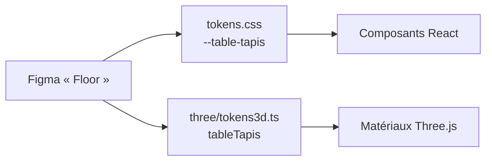
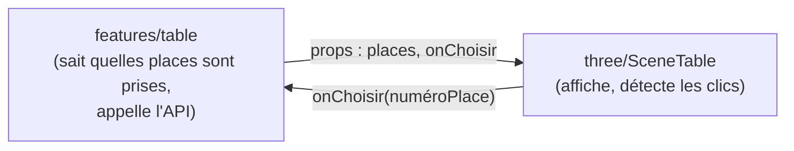

# `three/`

> **Tout le code 3D de l'application : la table de poker, les chaises, la caméra et ses animations.**
> Isolé dans son propre dossier parce que c'est un domaine technique à part, avec ses propres outils et son propre mode de pensée (scène, matériaux, boucle de rendu).

Vue d'ensemble du frontend : [`docs/frontend.md`](../../../docs/frontend.md).

> [!NOTE]
> **Statut : vide pour l'instant.** Le dossier ne contient qu'un `.gitkeep`. Ce document décrit ce qui est **prévu**.

## Les outils

| Bibliothèque | Rôle |
|---|---|
| **Three.js** | Le moteur 3D : géométries, matériaux, lumières, rendu WebGL |
| **React Three Fiber (R3F)** | Écrire une scène Three.js en JSX : `<mesh>`, `<ambientLight>`… React gère la création et la destruction des objets 3D |
| **Drei** | Aides prêtes à l'emploi pour R3F : `useGLTF` (charger un modèle), `OrbitControls`, `Html` (du HTML placé dans la scène)… |
| **GSAP** | Animations de caméra fluides (zoom sur une table, déplacement entre les vues) |

## Ce qui est prévu

- **La scène de la table** : tapis, rail et lignes, avec les couleurs `--table-tapis`, `--table-rail` et `--table-ligne`.
- **Les chaises interactives**, avec trois états : libre (`--chaise-libre`), occupée (`--chaise-occupee`), ta place (`--chaise-selection`). Un survol déclenche la lueur `--lueur-chaise-survol`.
- **La caméra** : zoom sur la table (`--duree-zoom-table: 700ms`) et animations GSAP.
- **Le chargement des modèles** `.glb`, rangés dans `frontend/public/models/`.
- **`tokens3d.ts`** : les couleurs des tokens converties pour Three.js. Ce fichier est déjà cité dans `tokens.css`, mais il n'existe pas encore.

### Pourquoi un `tokens3d.ts` ?

Three.js ne lit pas le CSS : un matériau attend une couleur JavaScript, comme `new Color('#284074')`, et pas `var(--table-tapis)`. Il faut donc une passerelle pour que la 3D et l'interface utilisent **les mêmes couleurs** :



Deux approches possibles, à trancher en équipe :
1. **Générer** `tokens3d.ts` depuis Figma en même temps que `tokens.css`.
2. **Lire les variables CSS à l'exécution** avec `getComputedStyle(document.documentElement).getPropertyValue('--table-tapis')`.

## Organisation interne (proposition)

```text
three/
├── tokens3d.ts        # couleurs des tokens, au format attendu par Three.js
├── SceneTable.tsx     # <Canvas> R3F : lumières, caméra, table, chaises
├── Table.tsx          # le modèle de la table (useGLTF)
├── Chaise.tsx         # une chaise : état, survol, clic
├── camera/            # animations GSAP de la caméra
└── index.ts           # ce que les features importent : SceneTable…
```

## Frontière avec `features/`



- `three/` **affiche** et **remonte les interactions** (clic sur une chaise).
- `features/` **décide** : quelles places sont libres, ce qui se passe au clic, l'appel à l'API.

C'est la même idée que le design system : la scène 3D reçoit ses données en props et ne va jamais chercher elle-même dans l'API.

## À garder en tête

- **Performance** : la scène est redessinée jusqu'à 60 fois par seconde. Évite de créer des objets (géométries, matériaux, `new Color()`) dans le rendu à chaque frame : crée-les une fois avec `useMemo`.
- **Fond** : derrière une scène 3D, le fond est `--fond-profond`.
- **Accessibilité** : un `<canvas>` est invisible pour un lecteur d'écran. Choisir une place doit aussi être possible **sans la 3D**, par exemple avec une liste de places en HTML.
- **Tests** : la 3D se teste mal dans jsdom (pas de WebGL). On teste plutôt la logique pure (calcul des positions, états des chaises) et on vérifie le rendu dans Storybook.
